<p align="center">
  
</p>

# ABG Dispatch

**Internal chain of custody for documents, parcels, instruments and assets
across Anvir Bashundhara Group.** Every movement is a verified handover on an
append-only ledger, so the group can always answer: *where is it, who holds
it, since when, who handed it over, and how was that proved?* Arriving at a
desk is never mistaken for being received.

| | |
|---|---|
| **Mobile app** (Flutter · Android & iOS) | Employees book parcels and receive them; couriers scan, take custody, move and deliver; guest carriers sign in with a phone code. English and Bangla. Works offline. |
| **Admin control centre** (React) | Live control room, parcel views and search, audited admin actions, analytics, registers and chain-of-custody reports, QR labels, offices / SLA / courier configuration, people and roles, audit log. |
| **API** (NestJS · PostgreSQL) | Object-level authorisation on every request, state machine enforced in code *and* in the database, notifications (in-app, push, SMS), SLA escalation, courier adapters (Pathao, REDX, Steadfast). |

<p>
  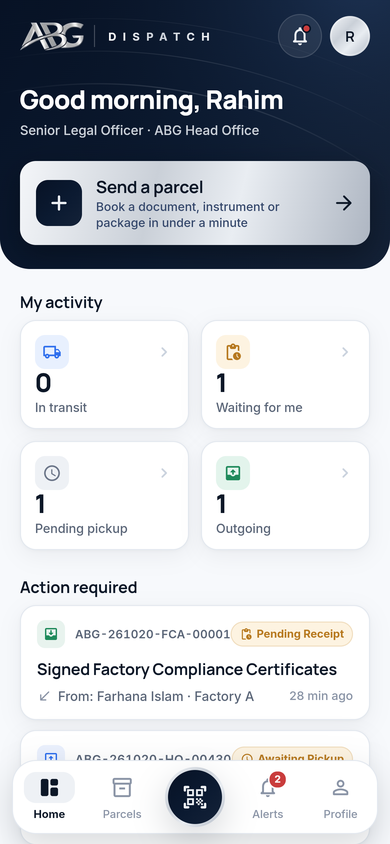
  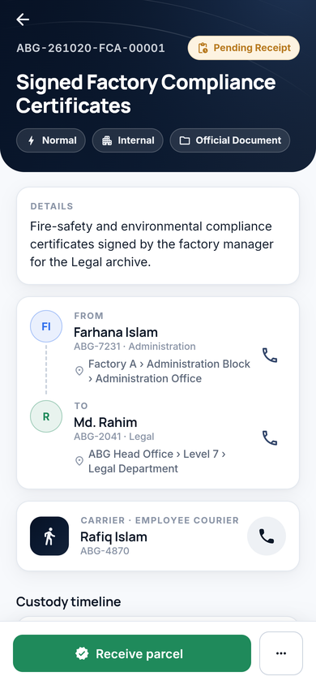
  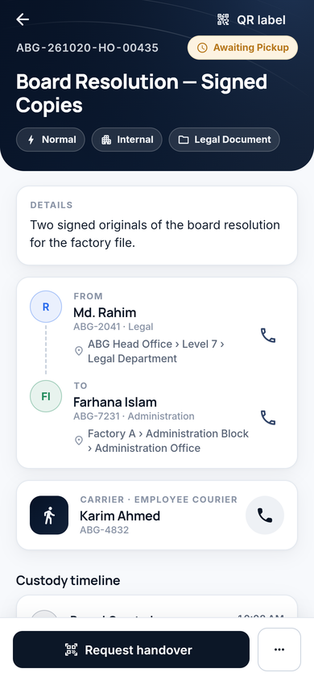
  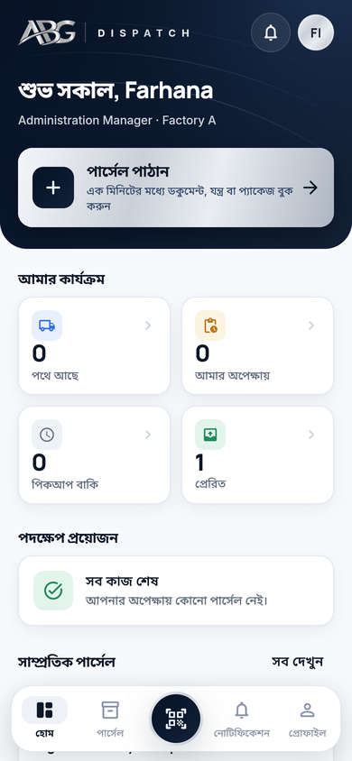
</p>

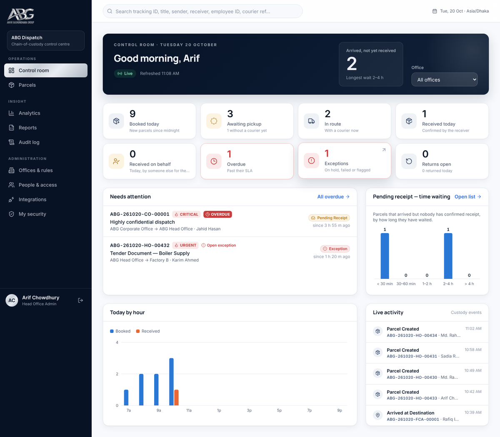

## How custody works

```
Booked ─▶ Awaiting Pickup ─▶ Picked Up ─▶ In Transit ─▶ Arrived ─▶ Pending Receipt ─▶ Received
             courier         verified        checkpoints     automatic      receiver confirms
             assigned        handover                                       (app · label scan · SMS code)
```

- **Handover** needs proof: the sender approves in the app, reads out a PIN,
  or a dispatch officer witnesses it.
- **Receipt** needs proof: in-app confirmation, scanning the physical label,
  or a one-time code; optionally on someone's behalf, recorded as such.
- **Three carrier types** in one record: employee couriers, external courier
  companies (provider, tracking number, rider), and guest carriers.
- **Classification** (Normal, Internal, Confidential, Highly Confidential)
  redacts contents from those who only move the parcel — including
  lock-screen notifications and printed labels.
- **SLA rules** remind, then escalate, and mark parcels overdue.

## Quick start

```bash
cd abg-dispatch
cp .env.docker.example .env      # fill in the secrets
docker compose up -d --build     # portal :18490 · API :18491 · Postgres :18434
docker compose exec api bun prisma/seed.ts
```

Sign in at http://localhost:18490 as `arif.chowdhury@abg.com.bd` /
`Dispatch@2026` (you'll be asked to set up two-factor first — production
mode). Development setup without Docker, mobile builds and production
deployment: **[docs/deployment.md](docs/deployment.md)**. Demo people and
parcels: **[docs/seed-data.md](docs/seed-data.md)**.

## Repository layout

```
abg-dispatch/
  packages/shared   statuses, transitions, roles → capabilities, labels, tokens, tracking IDs
  apps/api          NestJS + Prisma API, migrations, seed, tests
  apps/admin        admin control centre (React + Vite + Tailwind), nginx config
  apps/mobile       Flutter app (Android, iOS; web build for previews)
  brand/            ABG logo and app icons
  docs/             architecture and specifications
  docker-compose.yml, .env.docker.example
```

## Checks

```bash
bun run test                                   # 20 shared + 40 API tests (all 20 acceptance tests)
cd apps/admin && bun run typecheck
cd apps/mobile && flutter analyze && flutter test
```

## Deliverables

| # | Deliverable | Where |
|---|---|---|
| 1 | Architecture document | [docs/architecture.md](docs/architecture.md) |
| 2 | Entity-relationship diagram | [docs/data-model.md](docs/data-model.md) |
| 3 | Database schema and migrations | [apps/api/prisma](apps/api/prisma) |
| 4 | Role and permission matrix | [docs/permissions.md](docs/permissions.md) |
| 5 | State-machine specification | [docs/state-machine.md](docs/state-machine.md) |
| 6 | API specification | [docs/api.md](docs/api.md) |
| 7 | Flutter mobile app | [apps/mobile](apps/mobile) · [README](apps/mobile/README.md) |
| 8 | Responsive admin portal | [apps/admin](apps/admin) · [README](apps/admin/README.md) |
| 9 | Design system | [docs/design-system.md](docs/design-system.md) · [tokens](packages/shared/src/tokens.ts) |
| 10 | Notification engine | [workflows §7](docs/workflows.md#7-notifications) · `apps/api/src/notifications` |
| 11 | QR workflow | [workflows §2](docs/workflows.md#2-qr-label) |
| 12 | Proof-of-handover and receipt workflow | [workflows §3–5](docs/workflows.md#3-handover-custody-start) |
| 13 | SLA and escalation engine | [workflows §8](docs/workflows.md#8-sla-reminders-and-escalation) · `apps/api/src/sla` |
| 14 | Courier adapter architecture | [workflows §9](docs/workflows.md#9-external-couriers) · `apps/api/src/couriers` |
| 15 | Audit logging | [workflows §11](docs/workflows.md#11-corrections-and-audit) · `apps/api/src/audit` |
| 16 | Tests incl. the 20 acceptance tests | [docs/testing.md](docs/testing.md) · `apps/api/test` |
| 17 | Seed and demo data | [docs/seed-data.md](docs/seed-data.md) · `apps/api/prisma/seed.ts` |
| 18 | Deployment instructions | [docs/deployment.md](docs/deployment.md) |
| 19 | Environment variable template | [apps/api/.env.example](apps/api/.env.example) · [.env.docker.example](.env.docker.example) |
| 20 | Production security checklist | [docs/security-checklist.md](docs/security-checklist.md) |

## Screenshots

| Mobile | |
|---|---|
| 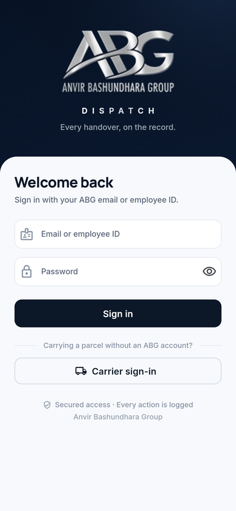 | 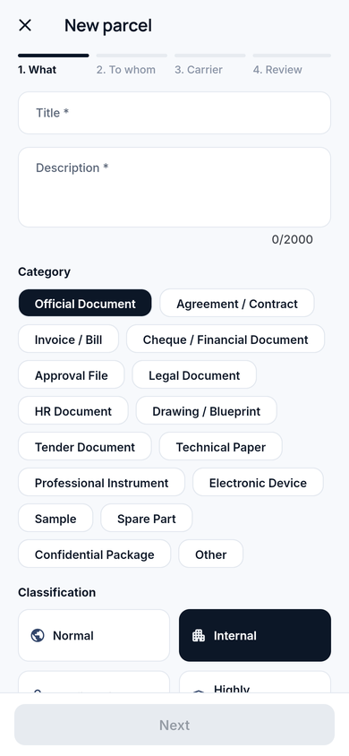 |
| 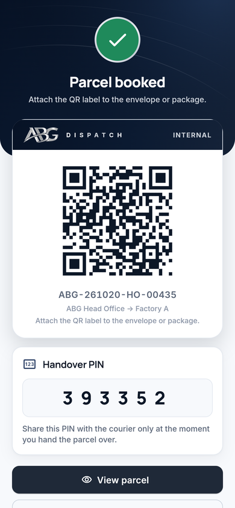 | 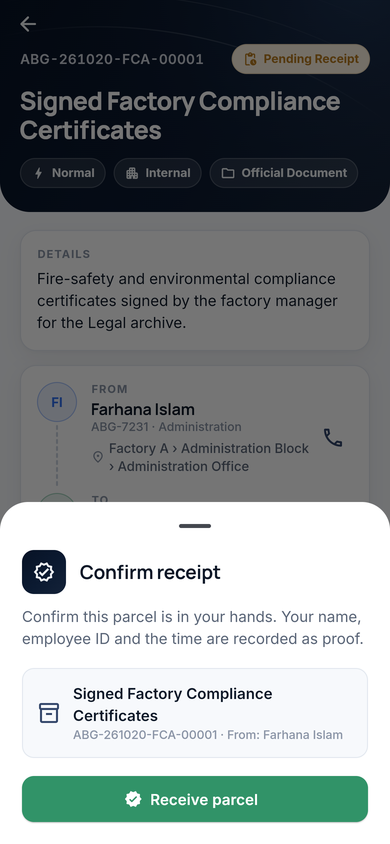 |
| 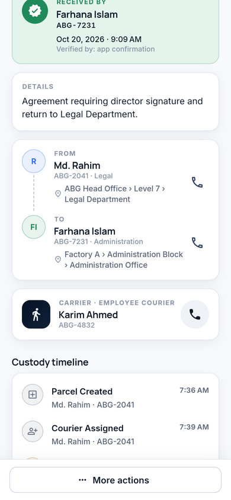 | 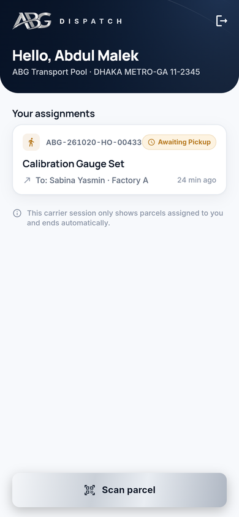 |

Admin control centre: [parcels](docs/screenshots/portal-03-parcels.png) ·
[parcel detail](docs/screenshots/portal-04-parcel-detail.png) ·
[assign courier](docs/screenshots/portal-05-assign-courier.png) ·
[analytics](docs/screenshots/portal-06-analytics.png) ·
[chain of custody](docs/screenshots/portal-07-chain-of-custody.png) ·
[QR label](docs/screenshots/portal-08-qr-label.png) ·
[SLA rules](docs/screenshots/portal-09-sla-rules.png) ·
[people & roles](docs/screenshots/portal-10-people-roles.png) ·
[sign-in](docs/screenshots/portal-01-sign-in.png)
