<p align="center">
  
</p>

# ABG ONE

**One app and one portal for the everyday operations of Anvir Bashundhara
Group:** official tours, pool cars, factory visitors, incidents, the
regulatory licence register, the official notice board and the parcel
chain of custody. Every request follows a set approval path, every step is
recorded on an append-only history, and the right people are told at once.

| | |
|---|---|
| **Mobile app** (Flutter · Android & iOS) | A services home for every employee: request a tour or a pool car, invite a visitor, report an incident, read and acknowledge notices, send and receive parcels. Approvers approve from their phone, security runs the gate desk (scan visitor and vehicle passes), drivers see their trips. English and Bangla. |
| **Admin portal** (React) | The executive dashboard, then one page per module: tour pipeline, pool car and fleet desk, visitor desk with a live on-site counter, incident inbox, licence register with expiry countdowns, notice board with read receipts, and the parcel control room, analytics, registers and audit log. |
| **API** (NestJS · PostgreSQL) | Object-level authorisation on every request, state machines enforced in code *and* in the database, signed QR gate passes, notifications (in-app, push, SMS), licence expiry escalation, SLA escalation, courier adapters. |

<p>
  
  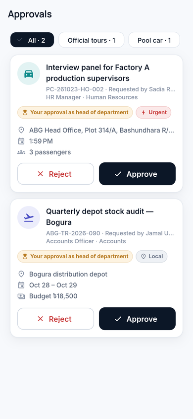
  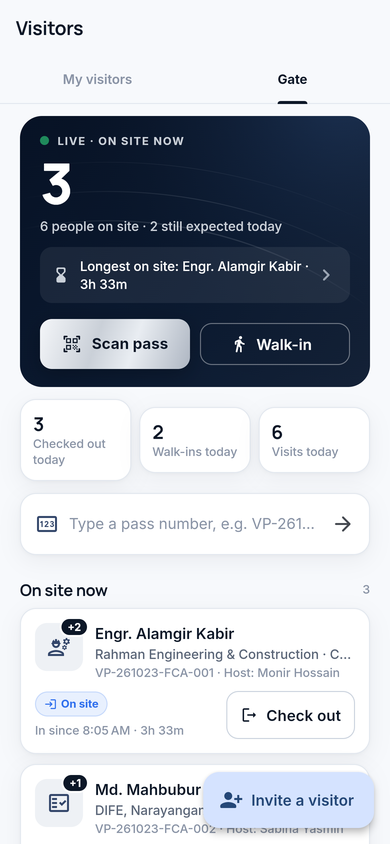
  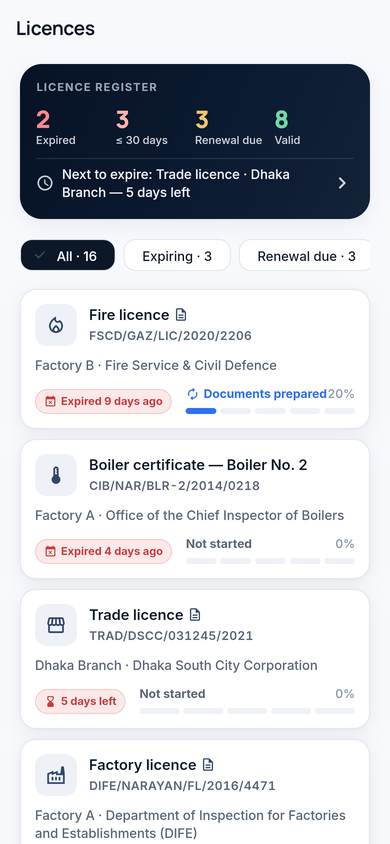
</p>

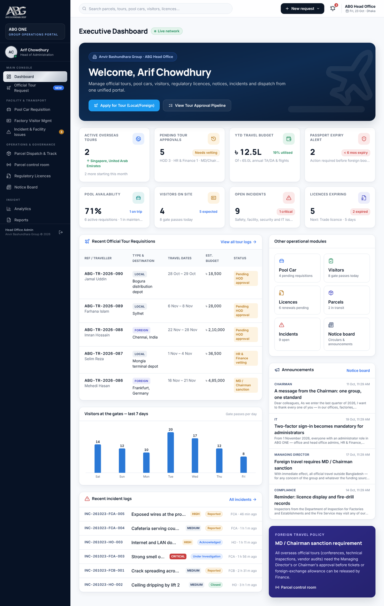

## Modules

| Module | What it does | Spec |
|---|---|---|
| **Executive dashboard** | Live KPIs across every module: overseas tours, pending approvals, travel budget used, passport alerts, pool car availability, visitors on site, open incidents, expiring licences; recent tours, visitor trend, incident log, announcements. | — |
| **Official tour request** | Local and overseas business travel: head of department → HR & Finance vetting → MD / Chairman sanction (overseas) → active → completed. Passport-validity alert, budget and sanctioned amount, four-eyes rules. `ABG-TR-2026-088` | [tours.md](docs/modules/tours.md) |
| **Pool car requisition & fleet** | Request a car → head of department → fleet manager assigns a vehicle and driver → QR vehicle gate pass scanned out and back in. Vehicle and driver register with service, fitness and insurance dates. `PC-261023-HO-004` | [fleet.md](docs/modules/fleet.md) |
| **Factory visitor management** | Pre-register a visitor or a walk-in, one-day QR gate pass texted to the visitor, check-in / check-out at the gate, host told at each step, live on-site counter. `VP-261023-FCA-012` | [visitors.md](docs/modules/visitors.md) |
| **Incident & facility issues** | Four groups (Safety & Industrial, Admin & Facility, Security, IT / Technical), 27 problem types, photos, severity Critical → Low, anonymous or confidential; Reported → Acknowledged → Under Investigation → Closed. | [incidents.md](docs/modules/incidents.md) |
| **Regulatory licence register** | Trade, factory, fire, environmental, BERC, explosives, boiler, IRC / ERC, BSTI: expiry countdown badges, renewal progress, scanned copies, alerts at 90 / 60 / 30 / 15 / 7 / 0 days escalating up to the MD / Chairman. | [licences.md](docs/modules/licences.md) |
| **Official notice board** | Chairman, MD, HR, Administration, Compliance and IT channels; urgent notices first, PDF attachments, "I have read and understood" acknowledgements with read receipts per person. `ABG-NB-2026-014` | [notices.md](docs/modules/notices.md) |
| **Parcel dispatch & tracking** | The chain of custody for documents, parcels and instruments — see below. | [workflows.md](docs/workflows.md) |

Every module follows one contract across the API, the portal and the app:
[docs/modules/README.md](docs/modules/README.md).

### Official tours

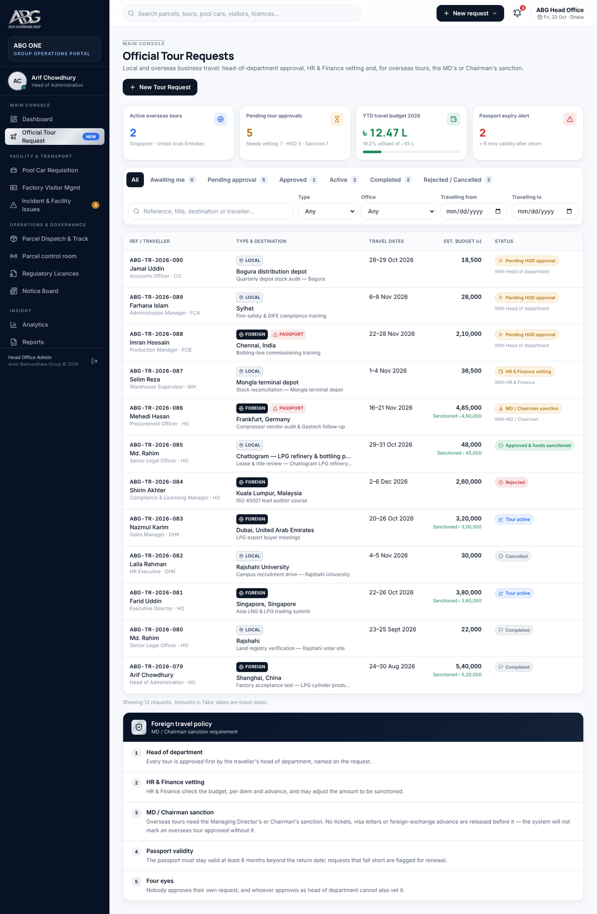

<p>
  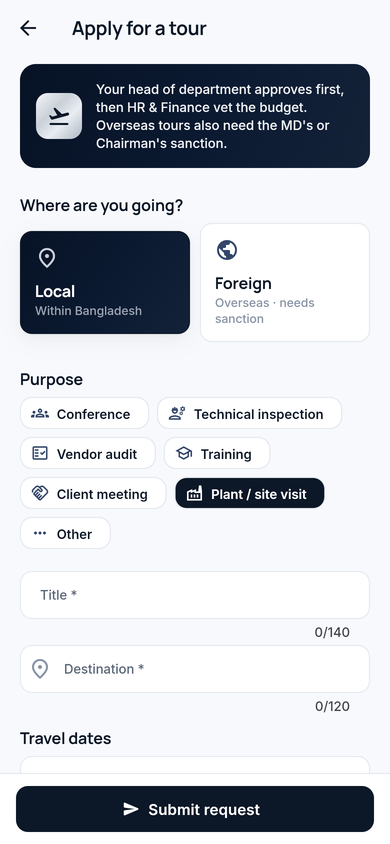
  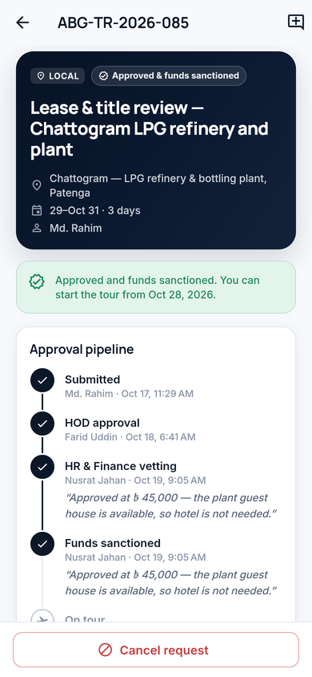
  
</p>

### Pool cars, visitors and the gate

<p>
  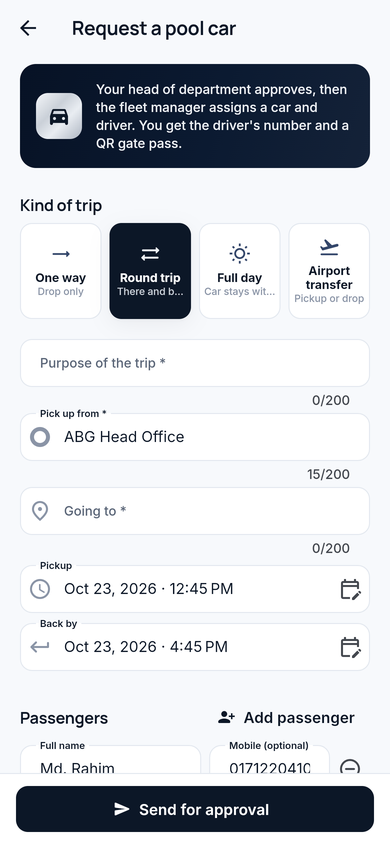
  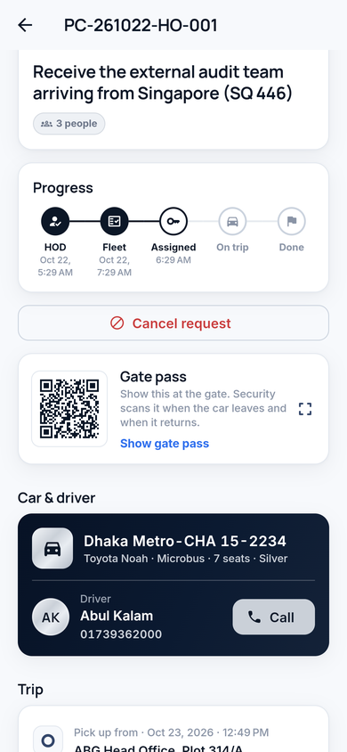
  
  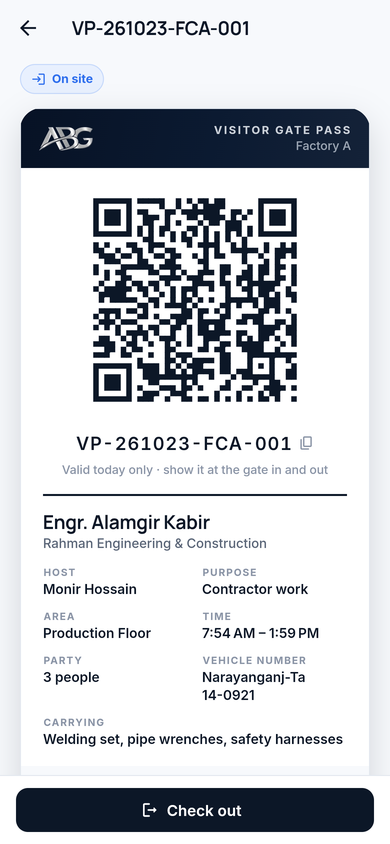
</p>

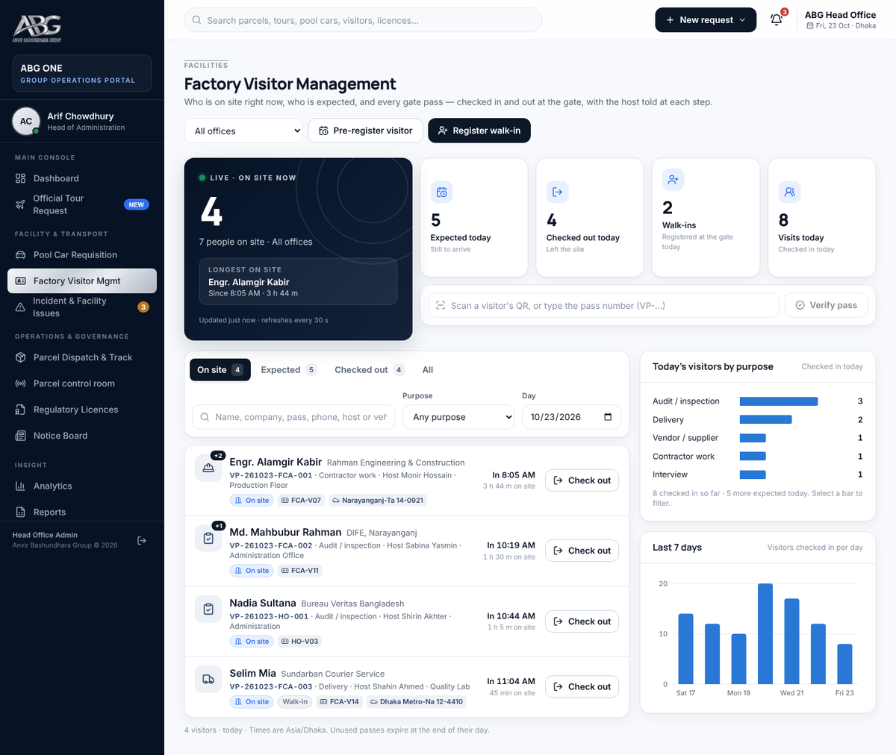

### Licences and notices

<p>
  
  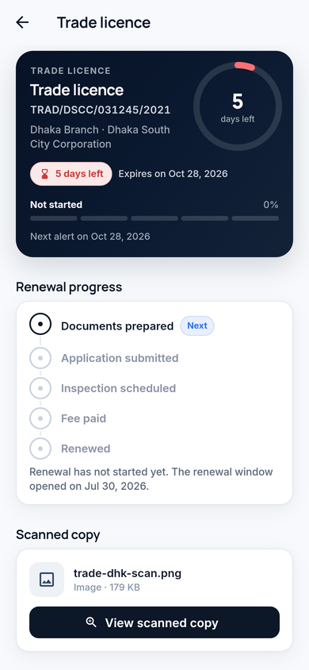
  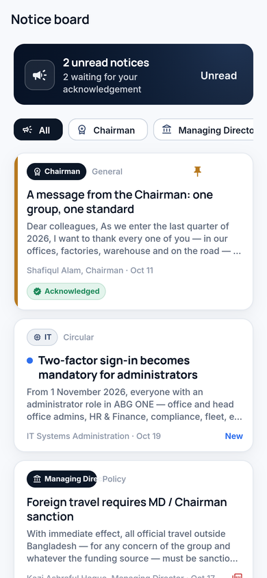
  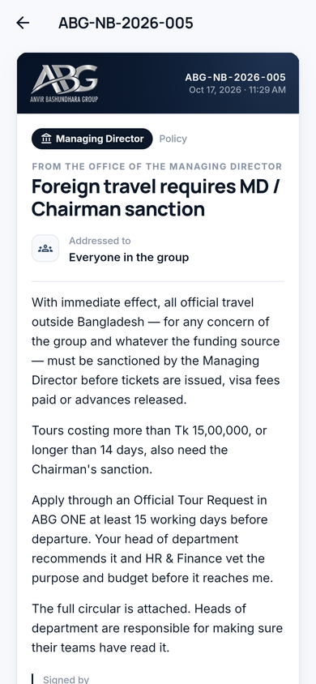
</p>

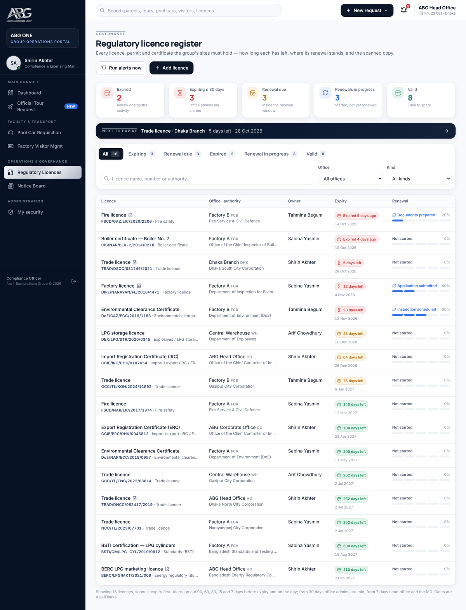

## Incident & facility issues

Any employee who sees a problem opens **Report an incident**, picks one of
four categories — **Safety & Industrial, Admin & Facility, Security,
IT/Technical** — and the exact problem (a gas leak, a broken washroom, a CCTV
fault, the network down…), adds a title and up to three photos (previewed
before sending), says where, tags the severity (**Critical, High, Medium,
Low**) and submits — anonymously, or as a **confidential** report that only
head office sees (misconduct always is). The office's admins and head office
are notified at once. Admins take each report **Reported → Acknowledged →
Under Investigation → Closed** (with a resolution: resolved, no action needed,
duplicate or referred) from the portal, with messages and photos of the fix,
and the reporter is notified and sees every stage in *My reports*.
Details: [workflows §13](docs/workflows.md#13-incident--facility-issues) and
[modules/incidents.md](docs/modules/incidents.md).

<p>
  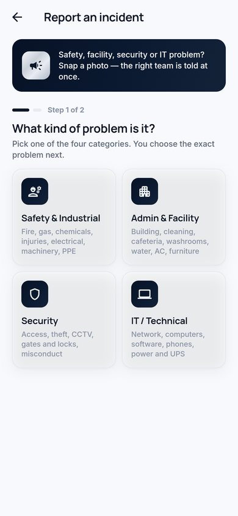
  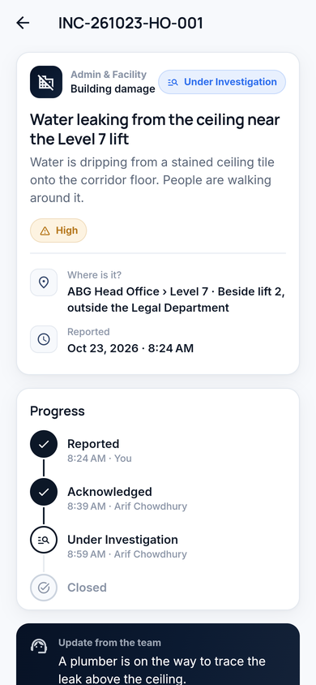
  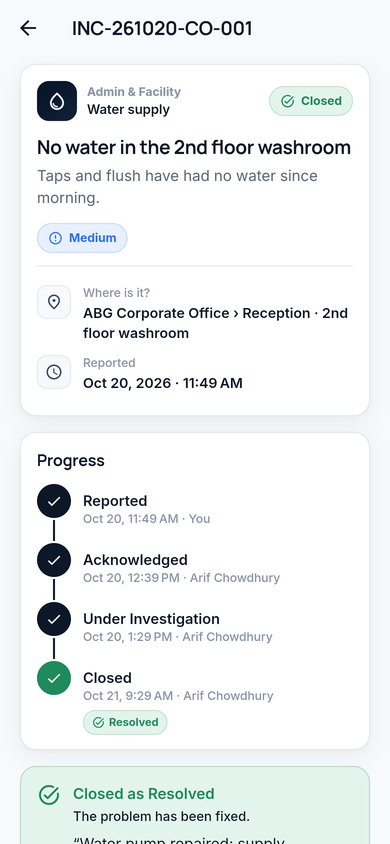
  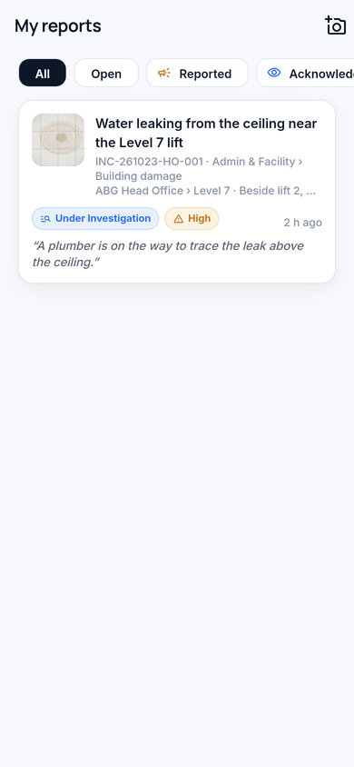
</p>

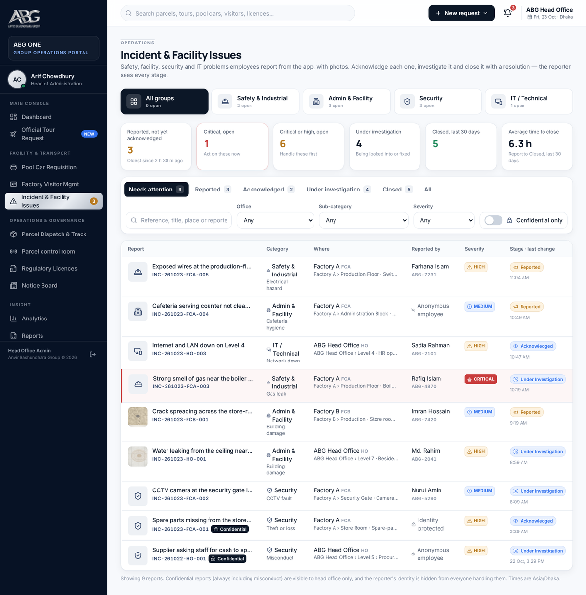

## Parcel dispatch: how custody works

Every parcel movement is a verified handover on an append-only ledger, so the
group can always answer: *where is it, who holds it, since when, who handed
it over, and how was that proved?* Arriving at a desk is never mistaken for
being received.

```
Booked ─▶ Awaiting Pickup ─▶ Picked Up ─▶ In Transit ─▶ Arrived ─▶ Pending Receipt ─▶ Received
             courier         verified        checkpoints     automatic      receiver confirms
             assigned        handover                                       (app · label scan · SMS code)
```

- **Handover** needs proof: the sender approves in the app, reads out a PIN,
  or a dispatch officer witnesses it.
- **Receipt** needs proof: in-app confirmation, scanning the physical label,
  or a one-time code; optionally on someone's behalf, recorded as such.
- **Three carrier types** in one record: employee couriers, external courier
  companies (provider, tracking number, rider), and guest carriers.
- **Classification** (Normal, Internal, Confidential, Highly Confidential)
  redacts contents from those who only move the parcel — including
  lock-screen notifications and printed labels.
- **SLA rules** remind, then escalate, and mark parcels overdue.

<p>
  
  
  
  
</p>


## Quick start

```bash
cd abg-dispatch
cp .env.docker.example .env      # fill in the secrets
docker compose up -d --build     # portal :18490 · API :18491 · Postgres :18434
docker compose exec api bun prisma/seed.ts
```

Sign in at http://localhost:18490 as `arif.chowdhury@abg.com.bd` /
`Dispatch@2026` (you'll be asked to set up two-factor first — production
mode). The seed creates 31 accounts covering every role — the MD and the
Chairman, HR & Finance, the fleet manager and drivers, security guards, the
compliance officer — with tours, pool car trips, visitors, licences, notices,
incidents and parcels to work with. Development setup without Docker, mobile
builds and production deployment: **[docs/deployment.md](docs/deployment.md)**.
Demo people and data: **[docs/seed-data.md](docs/seed-data.md)**.

## Repository layout

```
abg-dispatch/
  packages/shared   statuses, transitions, roles → capabilities, labels, tokens, reference numbers, gate passes
  apps/api          NestJS + Prisma API, migrations, seed, tests
  apps/admin        admin portal (React + Vite + Tailwind), nginx config
  apps/mobile       Flutter app (Android, iOS; web build for previews)
  brand/            ABG logo and app icons
  docs/             architecture and specifications; docs/modules for each ABG ONE module
  docker-compose.yml, .env.docker.example
```

## Checks

```bash
bun run test                                   # shared + API tests (the 20 parcel acceptance tests and every module's tests)
cd apps/admin && bun run typecheck
cd apps/mobile && flutter analyze && flutter test
```

## Deliverables

| # | Deliverable | Where |
|---|---|---|
| 1 | Architecture document | [docs/architecture.md](docs/architecture.md) · [module contract](docs/modules/README.md) |
| 2 | Entity-relationship diagram | [docs/data-model.md](docs/data-model.md) |
| 3 | Database schema and migrations | [apps/api/prisma](apps/api/prisma) |
| 4 | Role and permission matrix | [docs/permissions.md](docs/permissions.md) |
| 5 | State-machine specification | [docs/state-machine.md](docs/state-machine.md) · each module's spec in [docs/modules](docs/modules) |
| 6 | API specification | [docs/api.md](docs/api.md) · each module's spec in [docs/modules](docs/modules) |
| 7 | Flutter mobile app | [apps/mobile](apps/mobile) · [README](apps/mobile/README.md) |
| 8 | Responsive admin portal | [apps/admin](apps/admin) · [README](apps/admin/README.md) |
| 9 | Design system | [docs/design-system.md](docs/design-system.md) · [tokens](packages/shared/src/tokens.ts) |
| 10 | Notification engine | [workflows §7](docs/workflows.md#7-notifications) · `apps/api/src/notifications` |
| 11 | QR workflow | [workflows §2](docs/workflows.md#2-qr-label) · gate passes in [visitors.md](docs/modules/visitors.md) and [fleet.md](docs/modules/fleet.md) |
| 12 | Proof-of-handover and receipt workflow | [workflows §3–5](docs/workflows.md#3-handover-custody-start) |
| 13 | SLA and escalation engine | [workflows §8](docs/workflows.md#8-sla-reminders-and-escalation) · `apps/api/src/sla` · licence alerts in [licences.md](docs/modules/licences.md) |
| 14 | Courier adapter architecture | [workflows §9](docs/workflows.md#9-external-couriers) · `apps/api/src/couriers` |
| 15 | Audit logging | [workflows §11](docs/workflows.md#11-corrections-and-audit) · `apps/api/src/audit` |
| 16 | Tests incl. the 20 acceptance tests | [docs/testing.md](docs/testing.md) · `apps/api/test` |
| 17 | Seed and demo data | [docs/seed-data.md](docs/seed-data.md) · `apps/api/prisma/seed.ts` · `apps/api/prisma/seed-modules` |
| 18 | Deployment instructions | [docs/deployment.md](docs/deployment.md) |
| 19 | Environment variable template | [apps/api/.env.example](apps/api/.env.example) · [.env.docker.example](.env.docker.example) |
| 20 | Production security checklist | [docs/security-checklist.md](docs/security-checklist.md) |

## Screenshots

| Mobile | | | |
|---|---|---|---|
| 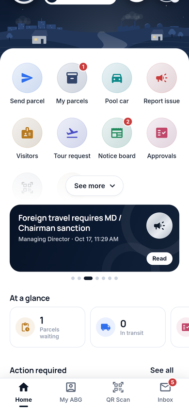 | 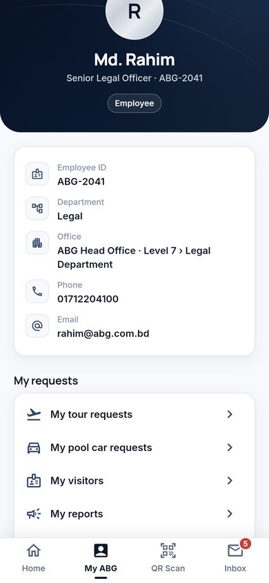 | 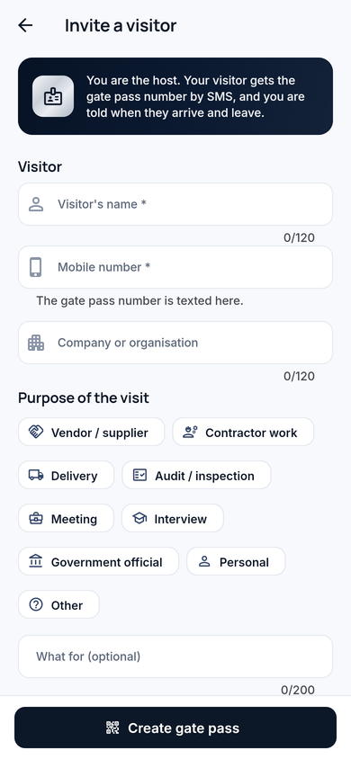 |  |
|  |  |  |  |

Admin portal: [executive dashboard](docs/screenshots/portal-13-executive-dashboard.png) ·
[tours](docs/screenshots/portal-14-tours.png) ·
[tour detail](docs/screenshots/portal-15-tour-detail.png) ·
[pool cars](docs/screenshots/portal-16-pool-car.png) ·
[pool car detail](docs/screenshots/portal-17-pool-car-detail.png) ·
[visitors](docs/screenshots/portal-18-visitors.png) ·
[visitor pass](docs/screenshots/portal-19-visitor-pass.png) ·
[licences](docs/screenshots/portal-20-licences.png) ·
[licence detail](docs/screenshots/portal-21-licence-detail.png) ·
[notices](docs/screenshots/portal-22-notices.png) ·
[notice detail](docs/screenshots/portal-23-notice-detail.png) ·
[incident reports](docs/screenshots/portal-11-incident-reports.png) ·
[incident detail](docs/screenshots/portal-12-incident-detail.png) ·
[on a phone](docs/screenshots/portal-24-on-a-phone.png) ·
[parcels](docs/screenshots/portal-03-parcels.png) ·
[parcel detail](docs/screenshots/portal-04-parcel-detail.png) ·
[assign courier](docs/screenshots/portal-05-assign-courier.png) ·
[analytics](docs/screenshots/portal-06-analytics.png) ·
[chain of custody](docs/screenshots/portal-07-chain-of-custody.png) ·
[QR label](docs/screenshots/portal-08-qr-label.png) ·
[SLA rules](docs/screenshots/portal-09-sla-rules.png) ·
[people & roles](docs/screenshots/portal-10-people-roles.png) ·
[sign-in](docs/screenshots/portal-01-sign-in.png)
