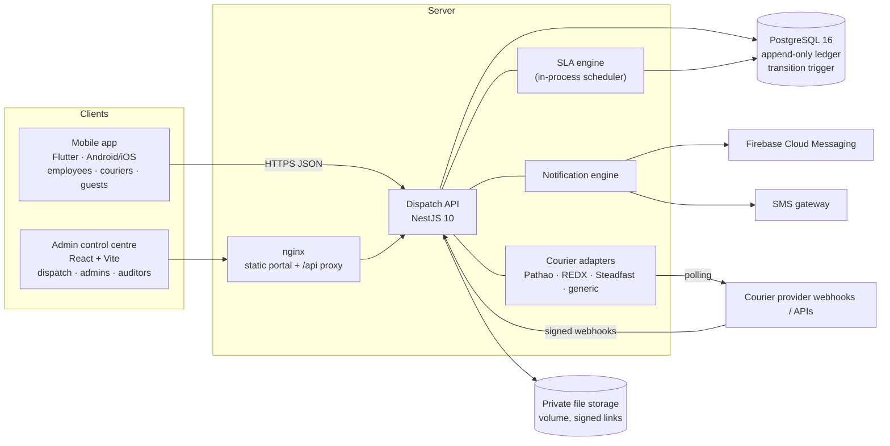

# Architecture

ABG Dispatch is an internal chain-of-custody system for documents, parcels,
instruments and small assets moving between Anvir Bashundhara Group offices,
factories and outside parties. Its core promise: at any moment the system can
say **who holds an item, since when, who handed it over, and how that was
proved** — and arriving at a desk is never mistaken for being received.

## Components

| Part | Where | Notes |
|---|---|---|
| Shared domain | `packages/shared` | Statuses, transition table, roles → capabilities, labels, tokens, tracking-number format. Compiled to CJS (API) and ESM (portal); the Flutter app mirrors it in `lib/models` and `lib/theme/tokens.dart`. |
| API | `apps/api` | NestJS + Prisma. One module, one global `AuthGuard`, services per concern (ledger, workflow, query, access, notifications, SLA, couriers, reports). |
| Database | `apps/api/prisma` | Schema, two migrations: tables, then integrity (append-only triggers, status-transition trigger, CHECK constraints, trigram search indexes). |
| Mobile app | `apps/mobile` | Flutter 3, provider + go_router, secure token storage, offline action queue, FCM push, EN/Bangla. |
| Admin portal | `apps/admin` | React 18, react-query, Tailwind. Served by nginx with a strict CSP; `/api` is proxied same-origin. |

## Request lifecycle

1. **Authenticate.** `AuthGuard` (global) verifies the JWT (15-minute access
   token; rotating refresh tokens stored as hashes; guest sessions separate),
   loads the actor (roles, capabilities, branch scopes) and rejects revoked
   sessions immediately. Routes are closed by default: `@Public()`,
   `@AllowGuest()`, `@AllowReadOnly()` and `@RequireCapability()` open them.
2. **Authorise the role.** Capability checks (`packages/shared/src/permissions.ts`).
   Privileged roles must have completed TOTP MFA when `REQUIRE_ADMIN_MFA` is on.
3. **Authorise the object.** `ParcelAccessService` computes the viewer's
   relation to *this* parcel (party, carrier, branch operations, head office,
   auditor, super admin, or a destination colleague holding the label). No
   relation → `404`, so existence never leaks. The same rules drive list
   filtering (`visibleWhere`) and search, and a test asserts the list filter
   and per-parcel check agree for every seeded user.
4. **Act.** Workflow methods run in one transaction that row-locks the parcel
   (`SELECT … FOR UPDATE`), re-validates the state machine, writes the event
   with the next gap-free sequence number, updates the parcel's milestone
   columns and commits. PostgreSQL then enforces the transition table again.
5. **Respond.** Parcels are serialised per viewer: content is redacted by
   classification, phones masked for auditors, QR payload only for those who
   may print it, and `viewer.actions` lists exactly the buttons the API will
   accept next.
6. **Notify.** After commit, the notification engine fans the event out
   (in-app row first, then push / SMS) and the realtime service publishes the
   change to the control room's server-sent-event stream.

## The custody ledger

Every state change, handover, receipt, note, attachment, correction and SLA
escalation is a row in `parcel_events`:

- **Append-only.** A trigger (`abg_forbid_mutation`) rejects `UPDATE` and
  `DELETE` on `parcel_events`, `parcel_proofs` and `audit_logs` — for the
  application and for anyone with SQL access.
- **Ordered.** `(parcelId, sequence)` is unique and sequences are gap-free.
- **Server time is the official time.** `serverTimestamp` is set by the API;
  the device's time is stored alongside (`deviceTimestamp`) for offline actions.
- **Snapshotted.** Actor name/code and location name are copied into the
  event, so renaming a person or office never rewrites history.
- **Corrections are new events.** `CORRECTION_ADDED` references the original
  via `correctsEventId`; the original stays untouched and the timeline marks it
  "has a later correction".
- **Idempotent.** Mobile actions carry an `Idempotency-Key`; the ledger has a
  unique idempotency key, so a retried or replayed offline action is applied
  exactly once.

The `parcels` row is a projection of the ledger (status, milestones, current
assignment, overdue/exception flags) kept in the same transaction.

## Modules in the API

| Concern | Files |
|---|---|
| Auth, sessions, MFA, guest OTP | `src/auth/*` |
| Object-level access & redaction | `src/parcels/parcel-access.service.ts`, `parcel-serializer.ts` |
| Ledger writes, locking, sequences | `src/parcels/ledger.service.ts` |
| Custody workflow (every action) | `src/parcels/parcel-workflow.service.ts` |
| Lists, search, scan, timeline | `src/parcels/parcel-query.service.ts` |
| Tracking numbers `ABG-YYMMDD-BRANCH-SEQ5` | `src/parcels/tracking-number.service.ts` |
| Attachments (sniffed types, private storage, signed links) | `src/attachments/*` |
| Notifications (in-app, FCM, SMS) | `src/notifications/*` |
| SLA reminders & escalations | `src/sla/sla.service.ts` |
| Courier adapters & webhooks | `src/couriers/*` |
| Control-room dashboard, saved views, SSE | `src/admin/admin-parcels.controller.ts`, `src/realtime/*` |
| Analytics & reports | `src/admin/analytics.service.ts`, `reports.service.ts` |
| Configuration & people | `src/admin/admin-config.controller.ts` |
| Audit log | `src/audit/audit.service.ts` |

## Time

All timestamps are stored in UTC (`timestamptz`). Everything shown to people is
in **Asia/Dhaka**: the apps format with that zone regardless of the device, and
SQL that groups by day or hour uses `AT TIME ZONE 'UTC' AT TIME ZONE 'Asia/Dhaka'`.
Report CSVs keep ISO-8601 UTC values so they sort and import cleanly.

## Scaling notes

The API is stateless apart from two in-process conveniences, both documented
where they live:

- the login/OTP **rate limiter** (move the same limits to the gateway when
  running more than one instance), and
- the **SLA scheduler** and the **realtime fan-out** (run the scheduler on one
  instance via `SLA_INTERVAL_SECONDS=0` elsewhere; put Redis pub/sub behind
  `RealtimeService` for multi-instance live feeds).

SLA triggers are unique per parcel and policy in the database, so two
schedulers can never double-escalate.

See also: [workflows](workflows.md) · [data model](data-model.md) ·
[state machine](state-machine.md) · [permissions](permissions.md) ·
[API](api.md) · [deployment](deployment.md) · [security checklist](security-checklist.md)
