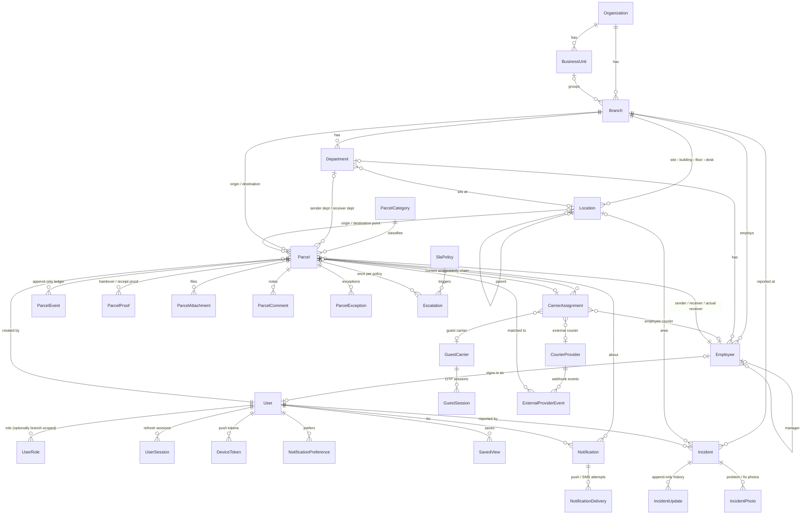

# Data model

Source of truth: [`apps/api/prisma/schema.prisma`](../apps/api/prisma/schema.prisma).
Migrations: [`apps/api/prisma/migrations`](../apps/api/prisma/migrations).

## Entity relationships

Standalone tables: `AuditLog` (append-only), `IdempotencyRecord`,
`TrackingSequence` (per office per day), `OtpChallenge` (hashed codes).

## Key tables

| Table | What it holds | Integrity |
|---|---|---|
| `parcels` | The projection: status, priority, classification, sender/receiver, origin/destination, milestone timestamps (`bookedAt` … `receivedAt`), actual receiver and on-behalf details, receipt verification, `qrToken` (opaque, 18 random bytes, base64url), handover PIN hash, overdue/exception flags, `lastEventSequence` | Status/priority/classification/method CHECKs; **status-transition trigger**; `RECEIVED` requires receiver name, time and verification (`parcels_received_has_receiver`); unique tracking number and QR token |
| `parcel_events` | The custody ledger: sequence, type, from/to status, actor type/id + name/code snapshots, location snapshot, server and device time, coordinates, verification method, proof id, notes, external provider, `correctsEventId`, metadata | **Append-only trigger**; unique `(parcelId, sequence)`; unique idempotency key |
| `parcel_proofs` | Handover/receipt proof records (method, verifier, OTP challenge, signature/photo attachment) | **Append-only trigger** |
| `carrier_assignments` | Every courier ever given the parcel: type, snapshots of name/phone/code, external tracking/booking refs, rider, timestamps (assigned, accepted, handover requested, custody start, end) | Carrier-type CHECK; at most one current per parcel |
| `parcel_attachments` | File metadata; bytes live in private storage keyed by a random name | Type sniffed from content, 10 MB cap |
| `otp_challenges` | Receipt and guest sign-in codes, **hashed with a pepper**, attempt counters, expiry | Single use |
| `sla_policies` / `escalations` | Configurable rules and the record of each trigger | Unique `(parcelId, slaPolicyId)` → never double-escalates |
| `external_provider_events` | Raw courier webhooks with outcome | Unique `(courierProviderId, externalEventId)` → replay guard |
| `audit_logs` | Administrative and security events with before/after JSON, actor, IP, user agent, session | **Append-only trigger** |
| `incidents` | Workplace incident reports: reference `INC-…`, title, description, category, severity, status (`PENDING`, `PROCESSING`, `DONE`, `DECLINED`), office, area, exact spot, reporter, `anonymous`, latest note for the reporter, `processingAt` / `doneAt` / `declinedAt` | Status, severity and category CHECKs; Done needs `doneAt`, Declined needs `declinedAt`; unique reference |
| `incident_updates` | Submitted, status changes, notes, photos and detail edits, with actor snapshot (`Anonymous employee` and no user id for anonymous reporters) | **Append-only trigger** |
| `incident_photos` | Photo metadata (`REPORT` or `RESOLUTION`); bytes in private storage | Kind CHECK; type sniffed from content |
| `idempotency_records` | Response cache for `Idempotency-Key` on create | Unique `(actorKey, key)` |

## Migrations

1. `20261020000100_init` — tables, enums-as-text, indexes, foreign keys.
2. `20261020000200_ledger_integrity` — `abg_forbid_mutation()` triggers on the
   three append-only tables; CHECK constraints; the `parcel_status_transitions`
   table (seeded from the shared state machine) and the
   `abg_check_status_transition()` trigger that rejects any status change not
   in it, even from raw SQL; `pg_trgm` indexes for fast "contains" search on
   titles, tracking numbers and employee names.

3. `20261020000300_incident_reports` — `incidents`, `incident_updates`,
   `incident_photos`; the append-only trigger on `incident_updates`; CHECK
   constraints; a `pg_trgm` index on incident titles.

Apply with `bun run db:migrate` (or automatically when the API container starts).
Tests assert that the database transition table equals the TypeScript one.

## Identifiers

- **Tracking number** `ABG-YYMMDD-BRANCH-SEQ5`, e.g. `ABG-261020-HO-00428`:
  date in Asia/Dhaka, origin office code, a per-office daily sequence from
  `tracking_sequences` (row-locked, so concurrent bookings never collide).
- **QR payload** `<PUBLIC_QR_BASE_URL>/q/<token>`. The token is random and
  reveals nothing; scanning it requires an authorised session to resolve.
- **Incident reference** `INC-YYMMDD-OFFICE-NNN`, e.g. `INC-261020-FCA-007`,
  numbered per office per day from the same sequence table.
- **Handover PIN** — six digits shown only to the sender, stored as a hash,
  locked after five wrong attempts.
