# Parcel state machine

Defined once in [`packages/shared/src/stateMachine.ts`](../packages/shared/src/stateMachine.ts),
enforced three times: by the workflow service (with a clear error), by the
transition trigger in PostgreSQL (for anything that bypasses the API), and in
the apps, which only show actions the API reports in `viewer.actions`.

**Clients never set a status.** They perform actions (confirm handover, mark
arrived, receive…); the server decides the resulting status.

## Happy path

```mermaid
stateDiagram-v2
  direction LR
  [*] --> DRAFT : save as draft
  [*] --> BOOKED : book
  DRAFT --> BOOKED : book draft
  BOOKED --> AWAITING_PICKUP : courier assigned
  AWAITING_PICKUP --> PICKED_UP : verified handover
  PICKED_UP --> IN_TRANSIT : leaves origin
  IN_TRANSIT --> ARRIVED_AT_DESTINATION : arrives
  ARRIVED_AT_DESTINATION --> PENDING_RECEIPT : automatic, same transaction
  PENDING_RECEIPT --> RECEIVED : receiver confirms (app / QR / OTP)
  RECEIVED --> [*]
```

`ARRIVED ≠ RECEIVED`. Arrival moves the parcel straight to **Pending Receipt**
and notifies the receiver; it is *received* only when a person confirms, with
a recorded verification method. A courier saying "delivered" (external
webhook) also lands in Pending Receipt for ABG receivers; only for an external
receiver outside ABG does the courier's proof of delivery count as the receipt.

## Every transition

| From | Allowed to |
|---|---|
| Draft | Booked, Cancelled |
| Booked | Awaiting Pickup, On Hold, Cancelled |
| Awaiting Pickup | Picked Up, Booked (courier removed), On Hold, Cancelled |
| Picked Up | In Transit, Exception, On Hold, Return Requested |
| In Transit | Arrived, Exception, On Hold, Return Requested |
| Arrived | Pending Receipt, Exception |
| Pending Receipt | Received, Exception, Delivery Failed, On Hold, Return Requested |
| On Hold | Booked, Awaiting Pickup, Picked Up, In Transit, Pending Receipt, Return Requested, Cancelled |
| Exception | Picked Up, In Transit, Arrived, Pending Receipt, Delivery Failed, On Hold, Return Requested, Return In Transit |
| Delivery Failed | In Transit, Pending Receipt, Return Requested |
| Return Requested | Return In Transit, Exception |
| Return In Transit | Returned, Exception |
| **Received**, **Returned**, **Cancelled** | — terminal |

Cancelling is possible only before custody starts (Draft, Booked, Awaiting
Pickup, On Hold). Once a courier holds a parcel, the way back is a **return**.

## Actions → events

| Action (who) | Event(s) | Status after |
|---|---|---|
| Book (employee) | `PARCEL_CREATED` (+ `PARCEL_BOOKED` from draft) | Booked |
| Assign / reassign courier (sender before pickup, dispatch, admins) | `CARRIER_ASSIGNED` / `CARRIER_REASSIGNED` | Awaiting Pickup |
| Accept assignment (courier) | `CARRIER_ACCEPTED` | — |
| Request handover (courier scans label) | `HANDOVER_REQUESTED` | — |
| Confirm handover — sender in app, sender's PIN, or dispatch officer | `HANDOVER_CONFIRMED`, `PICKED_UP` | Picked Up |
| Start transit / checkpoint (courier, dispatch for external) | `IN_TRANSIT` / `CHECKPOINT` | In Transit |
| Mark arrived (courier, destination desk) | `ARRIVED_AT_DESTINATION`, `PENDING_RECEIPT` | Pending Receipt |
| Send receipt code (courier, desk) | `RECEIPT_OTP_SENT` | — |
| Receive — in app, by scanning the label, or with the receiver's code; optionally on behalf with a reason | `RECEIVED` | Received |
| Record exception / put on hold / delivery failed | `EXCEPTION_RECORDED` (+ `PUT_ON_HOLD` / `DELIVERY_FAILED`) | Exception / On Hold / Delivery Failed or unchanged |
| Resolve exception (operations) | `EXCEPTION_RESOLVED` (+ `RELEASED_FROM_HOLD`) | previous status or chosen resume status |
| Request / start / complete return | `RETURN_REQUESTED`, `RETURN_IN_TRANSIT`, `RETURNED` | … Returned |
| Cancel | `CANCELLED` | Cancelled |
| Note, attachment, correction, deadline change | `NOTE_ADDED`, `ATTACHMENT_ADDED`, `CORRECTION_ADDED`, `EXPECTED_DELIVERY_CHANGED` | — |
| SLA engine | `SLA_REMINDER`, `SLA_ESCALATED` | — (sets overdue) |
| Courier webhook / manual courier status | `EXTERNAL_STATUS_UPDATE` (+ mapped custody event) | mapped; "delivered" → Pending Receipt (Received only for external receivers) |
| Resend notification (operations) | `NOTIFICATION_RESENT` | — |

## Concurrency

Each action locks the parcel row, re-reads its status, validates, writes and
commits in one transaction. A second "Receive" arriving a moment later sees
`RECEIVED` and gets `409 ALREADY_RECEIVED` with who received it and when; a
replay with the same idempotency key returns the first result. Acceptance
test 16 double-taps Receive concurrently and asserts exactly one `RECEIVED`.
