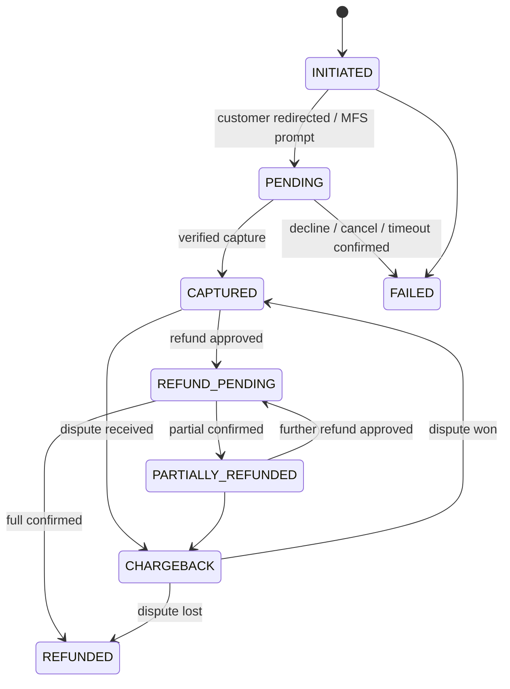
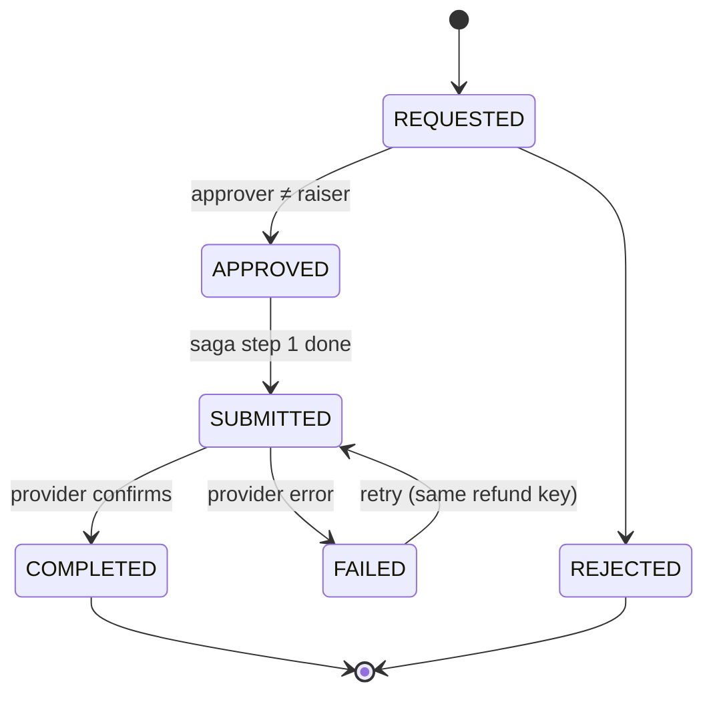
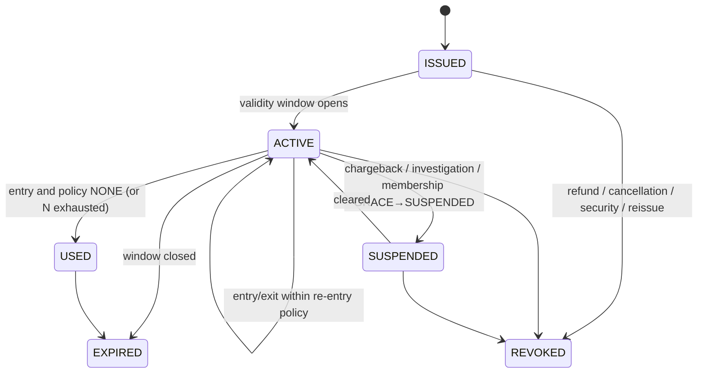
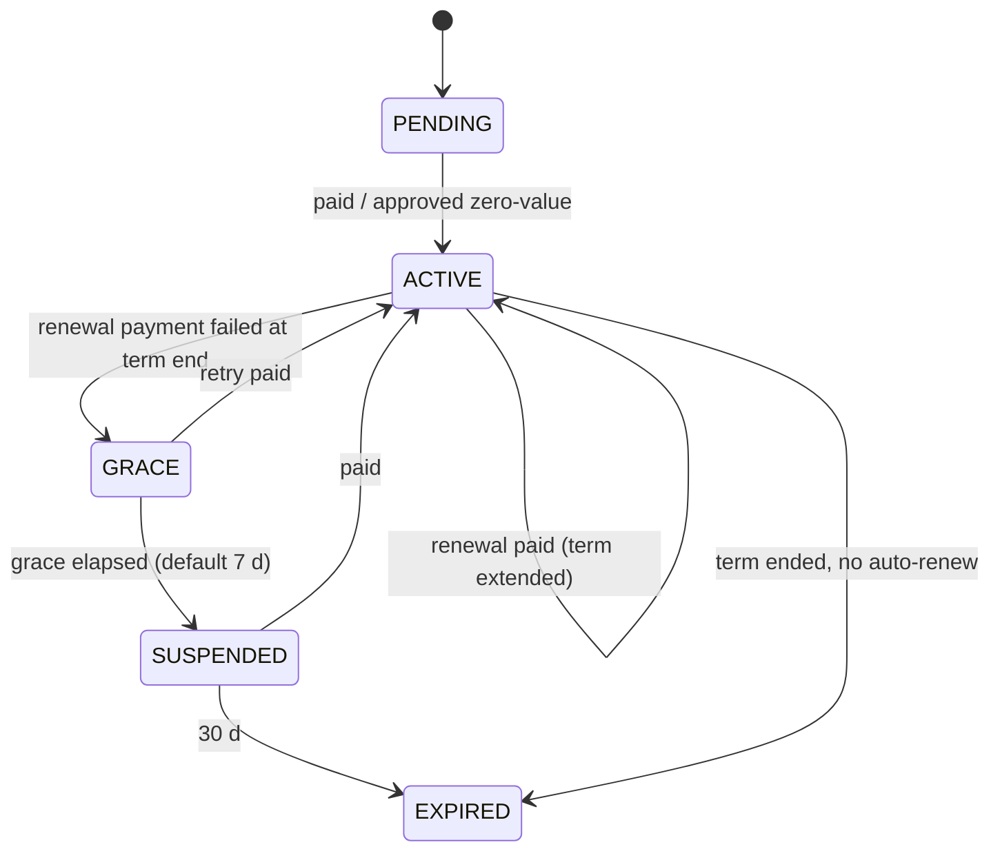
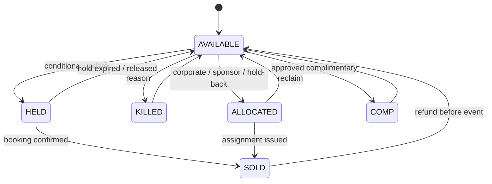
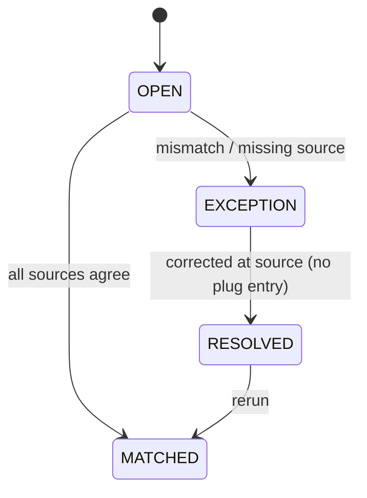
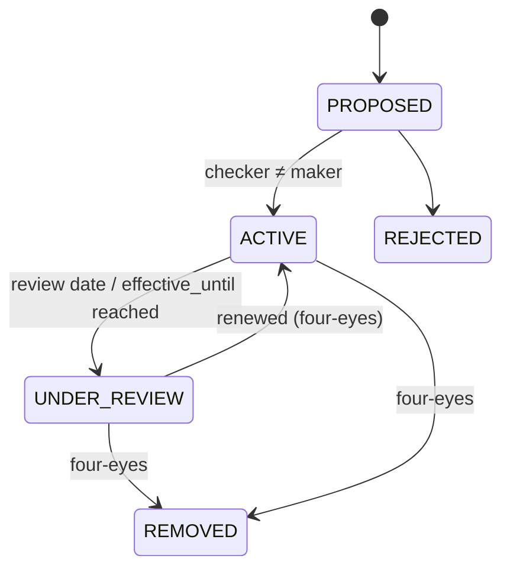
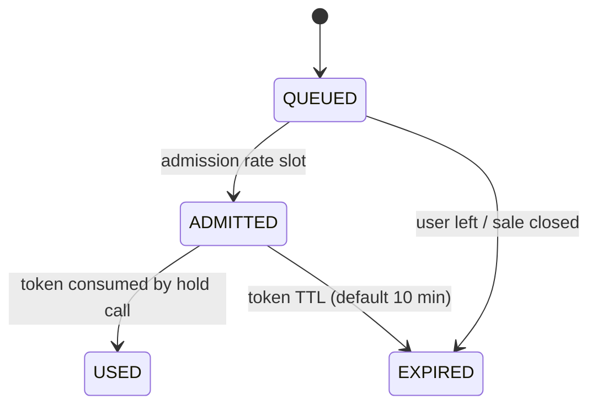
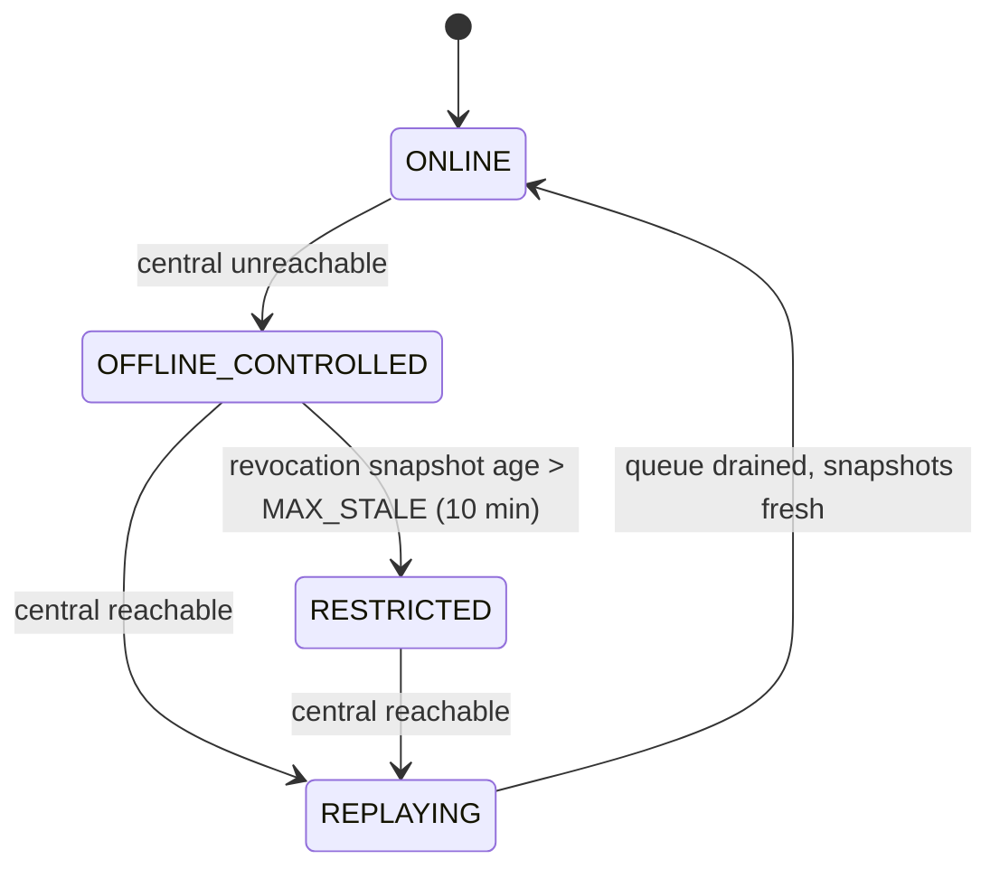

# 5. Data model

## 5.1 Principles

| ID | Rule | Class | Source |
|---|---|---|---|
| TSA-DAT-001 | Identity SHALL be separated from booking, credential and payment data. Joins go through surrogate IDs. | DERIVED-MANDATORY | Parent §29.3 field-level access controls |
| TSA-DAT-002 | NID/passport numbers SHALL be envelope-encrypted with a KMS/HSM key, with a deterministic keyed blind index (HMAC-SHA-256) for dedupe. They SHALL be masked by default; full reveal is permissioned (R-17 approval) and audited. | SRS-SHALL | §29.3; §33.3 |
| TSA-DAT-003 | The biometric vault SHALL be isolated (separate store, key, network segment). TSA holds only BIOMETRIC_PROFILE surrogate references. | SRS-SHALL | §29.3 |
| TSA-DAT-004 | No PII SHALL appear in logs, metric labels or analytics without a registered purpose. Analytics use the pseudonymous `subject_ref`. | DERIVED-MANDATORY | Parent §29.3; PDPA 2026 purpose limitation `[LEGAL-VERIFY]` |
| TSA-DAT-005 | Each entity SHALL have a retention schedule with automated purge (§5.5). The deletion ledger SHALL be re-applied on any restore. | SRS-SHALL | §29.3; B8 |
| TSA-DAT-006 | Master data: visitors are mastered in TSA; employees in HRM; vendor contacts in the Vendor module; assets / facilities in Facility Management. Non-TSA masters are referenced, never copied (§29.2). | SRS-SHALL | §29.2 |
| TSA-DAT-007 | Money SHALL be `NUMERIC(14,2)` with an ISO 4217 currency. Timestamps SHALL be `timestamptz` UTC, with an IANA zone stored on slots and events (A-01, A-02). | DERIVED-MANDATORY | A-01; A-02 |

## 5.2 ERD

```mermaid
erDiagram
  VISITOR ||--o{ IDENTITY_DOCUMENT : has
  VISITOR ||--o{ CONSENT : gives
  VISITOR ||--o| BIOMETRIC_PROFILE : "may enrol"
  VISITOR ||--o{ GUARDIAN_LINK : "guardian/minor"
  ACCESS_SUBJECT }o--o| VISITOR : "is (visitor types)"
  ACCESS_SUBJECT }o--o| BIOMETRIC_PROFILE : "face ref"
  FACILITY ||--o{ RESOURCE : contains
  RESOURCE ||--o{ RESOURCE_SLOT : offers
  EVENT ||--o{ RESOURCE_SLOT : "scheduled in"
  EVENT ||--o| SEAT_MAP : uses
  RESOURCE_SLOT ||--o{ INVENTORY_UNIT : exposes
  TICKET_PRODUCT ||--o{ PRICE_VERSION : priced
  TICKET_PRODUCT }o--|| TAX_CODE : taxed
  TICKET_PRODUCT }o--|| GL_MAPPING : posts
  GL_MAPPING }o--|| COST_CENTRE : to
  MEMBERSHIP_PLAN ||--o{ MEMBERSHIP : instantiates
  MEMBERSHIP ||--o{ MEMBERSHIP_MEMBER : has
  VISITOR ||--o{ BOOKING : places
  BOOKING ||--o{ BOOKING_ITEM : contains
  BOOKING_ITEM ||--o{ HOLD : reserves
  HOLD }o--|| INVENTORY_UNIT : locks
  BOOKING_ITEM ||--o{ ATTENDEE : for
  ATTENDEE ||--|| TICKET : "one per attendee"
  TICKET }o--|| ACCESS_SUBJECT : holder
  PROMOTION ||--o{ PROMOTION_REDEMPTION : redeemed
  PROMOTION_REDEMPTION }o--|| BOOKING : on
  BOOKING ||--o{ PAYMENT : paid
  PAYMENT ||--o{ PAYMENT_ATTEMPT : tries
  PAYMENT ||--o{ PROVIDER_EVENT : callbacks
  PAYMENT ||--o{ REFUND : reversed
  PAYMENT ||--o{ CHARGEBACK : disputed
  VISITOR ||--o{ PAYMENT_INSTRUMENT : owns
  VISITOR ||--o{ TRANSACTION_LEDGER : history
  BOOKING ||--o{ TAX_DOCUMENT : invoiced
  CREDENTIAL }o--o| TICKET : "owner (one of)"
  CREDENTIAL }o--o| MEMBERSHIP_MEMBER : "owner (one of)"
  CREDENTIAL }o--o| SEASON_ENTITLEMENT : "owner (one of)"
  CREDENTIAL }o--o| ACCESS_SUBJECT : "owner (staff, one of)"
  CORPORATE_ACCOUNT ||--o{ ALLOCATION_POOL : holds
  ALLOCATION_POOL ||--o{ SPONSOR_ENTITLEMENT : backs
  ZONE ||--o{ GATE : "entered via"
  GATE ||--o{ DEVICE : has
  ZONE ||--o{ ZONE_PERMISSION : governed
  CREDENTIAL ||--o{ ACCESS_EVENT : "used in"
  DEVICE ||--o{ ACCESS_EVENT : records
  ACCESS_EVENT }o--o| OVERRIDE : "may have"
  ACCESS_SUBJECT ||--o{ BLACKLIST_ENTRY : listed
  BLACKLIST_ENTRY ||--o{ BLACKLIST_MATCH_LOG : matches
  SHIFT ||--o{ CASH_DRAWER : has
  RECONCILIATION_BATCH ||--o{ RECONCILIATION_ITEM : contains
  RECONCILIATION_BATCH ||--o{ JOURNAL_EXPORT : produces
```

## 5.3 Physical table list

All tables have `id UUID (v7) PK`, `created_at`, `updated_at` and `version` (optimistic lock).

**Classification codes** (§8.3):
- **PUB** — Public.
- **INT** — Internal.
- **PII** — Confidential PII.
- **RID** — Restricted Identity.
- **RBI** — Restricted Biometric.
- **RSE** — Restricted Security.
- **RFI** — Restricted Financial.
- **SEC** — Secret.

Retention codes refer to §5.5.

| Table | Key FKs | Key attributes | Class | Retention |
|---|---|---|---|---|
| ACCESS_SUBJECT | visitor_id?, biometric_profile_id? | subject_type (§4.2), hrm_employee_ref?, vendor_contact_ref?, sports_roster_ref?, subject_ref (pseudonym), status. CHECK: exactly one of visitor_id / hrm_employee_ref / vendor_contact_ref / sports_roster_ref, **or** subject_type = WATCHLIST_UNKNOWN with biometric_profile_id only | PII | RT-ID |
| VISITOR | — | full_name, name_bn, dob, mobile_e164, email, preferred_lang, status, face_opt_in, blind_idx_mobile, blind_idx_email | PII | RT-ID |
| GUARDIAN_LINK | guardian_visitor_id, minor_visitor_id, consent_id | relationship, valid_until; CHECK guardian ≠ minor | PII | RT-ID |
| CONSENT | visitor_id | purpose, notice_version, notice_hash, lawful_basis, channel, language, accepted (bool), granted_at, withdrawn_at; append-only | PII | RT-CONS |
| BIOMETRIC_PROFILE | visitor_id? | vault_ref (surrogate), provider, quality_score, pad_passed, enrolled_at, deleted_at | RBI | RT-BIO |
| IDENTITY_DOCUMENT | visitor_id | doc_type, doc_number_ciphertext, doc_blind_index, country, expiry, verification_status; UNIQUE(doc_type, doc_blind_index, country) | RID | RT-ID |
| FACILITY | asset_ref (FAC master) | name_bn, name_en, site | INT | RT-MD |
| RESOURCE | facility_id | type (court / ground / lane / pool / area), sport, capacity, bookable | INT | RT-MD |
| RESOURCE_SLOT | resource_id, event_id? | start, end, tz, status (OPEN / MAINTENANCE / BLOCKED); EXCLUDE overlap per resource | INT | RT-TXN |
| SEAT_MAP | event_id / facility_id | version, sections JSON, seat flags (accessible / companion / obstructed) | PUB | RT-MD |
| INVENTORY_UNIT | slot_id, seat_id?, pool_id? | inventory_type, status (§6.6), kill_reason, current_hold_id, booking_item_id; UNIQUE(slot_id, unit_key) | INT | RT-TXN |
| EVENT | event_master_ref (Event module) | name_bn, name_en, start, end, tz, category (A / B / C), gates_open_at | PUB | RT-MD |
| TICKET_PRODUCT | facility_id, tax_code_id, gl_mapping_id | all fields in TSA-CAT-002 | INT | RT-MD |
| PRICE_VERSION | product_id | channel, currency, amount, valid_from/to, approved_by; EXCLUDE overlapping validity | RFI | RT-FIN |
| TAX_CODE | — | code, rate, inclusive, effective_from, legal_ref `[LEGAL-VERIFY]` | INT | RT-FIN |
| MEMBERSHIP_PLAN | tax_code_id, gl_mapping_id | plan_type, term, benefits, zone_set, eligibility | INT | RT-MD |
| MEMBERSHIP | plan_id, holder_visitor_id, corporate_account_id? | status (§6.5), start, end, mandate_instrument_id | PII | RT-FIN |
| MEMBERSHIP_MEMBER | membership_id, visitor_id | role (PRIMARY / LINKED), status | PII | RT-FIN |
| SEASON_ENTITLEMENT | visitor_id, product_id | fixtures[], seat_id, status | PII | RT-FIN |
| PROMOTION | — | code_blind_index, kind, value, scope, eligibility, caps, window | INT | RT-FIN |
| PROMOTION_REDEMPTION | promotion_id, booking_id, visitor_id | amount; UNIQUE(promotion_id, booking_id) | RFI | RT-FIN |
| BOOKING | visitor_id or corporate_account_id, waiting_room_session_id? | channel, status (§6.1), totals, currency, correlation_id | RFI | RT-FIN |
| BOOKING_ITEM | booking_id, product_id, price_version_id, slot_id? | qty, unit_amount, discount, tax | RFI | RT-FIN |
| HOLD | booking_item_id, inventory_unit_id | expires_at, absolute_ceiling_at, retry_extensions, status; partial UNIQUE(inventory_unit_id) WHERE status = ACTIVE | INT | RT-TXN |
| ATTENDEE | booking_item_id, access_subject_id? | name_placeholder, named_at, cut_off_at | PII | RT-FIN |
| TICKET | attendee_id (UNIQUE), holder_subject_id | status (§6.4), validity window, reentry_policy, uses_count | PII | RT-FIN |
| CREDENTIAL | ticket_id? / membership_member_id? / season_entitlement_id? / staff_subject_id? | type, owner_type (generated), token_hash, key_id, status, valid_from, valid_to, first_used_at. **CHECK num_nonnulls(ticket_id, membership_member_id, season_entitlement_id, staff_subject_id) = 1**; UNIQUE(type, token_hash) | RSE | RT-ACC |
| PAYMENT | booking_id or service_client_order_ref (F&B) | provider, method, amount, currency, status (§6.2), provider_txn_id; UNIQUE(provider, provider_txn_id) | RFI | RT-FIN |
| PAYMENT_ATTEMPT | payment_id | attempt_no, initiated_at, outcome, failure_code | RFI | RT-FIN |
| PROVIDER_EVENT | payment_id? | provider, provider_event_id, signature_valid, payload_hash, received_at, processed_at; **UNIQUE(provider, provider_event_id)** | RFI | RT-FIN |
| PAYMENT_INSTRUMENT | visitor_id | provider, token_ref, brand, masked (last4 / MSISDN), expiry, mandate_consent_id | RFI | RT-FIN |
| TRANSACTION_LEDGER | visitor_id, payment_id | source (TSA / FNB), source_ref, direction, amount, occurred_at; UNIQUE(source, source_ref, direction); append-only | RFI | RT-FIN |
| REFUND | payment_id, raised_by, approved_by | amount, reason_code, status (§6.3), provider_refund_ref, credit_note_id; CHECK raised_by ≠ approved_by | RFI | RT-FIN |
| CHARGEBACK | payment_id | provider_case_ref, amount, status, deadline | RFI | RT-FIN |
| TAX_DOCUMENT | booking_id, original_doc_id? | doc_type (MUSHAK_6_3 / CREDIT_NOTE `[LEGAL-VERIFY form]`), issuing_point, serial_no, totals, issued_at; **UNIQUE(issuing_point, doc_type, serial_no)** | RFI | RT-VAT |
| CORPORATE_ACCOUNT | — | name, BIN `[LEGAL-VERIFY]`, credit_limit, terms | INT | RT-FIN |
| ALLOCATION_POOL | event_id, corporate_account_id? / sponsor_package_ref? | qty, assigned, reclaim_at; CHECK assigned ≤ qty | INT | RT-FIN |
| SPONSOR_ENTITLEMENT | allocation_pool_id | entitled_qty, consumed_qty | INT | RT-FIN |
| ZONE | parent_zone_id? | code, capacity, risk_level | RSE | RT-MD |
| GATE | zone_id | code, direction, modalities[], reentry_policy, offline_risk_class | RSE | RT-MD |
| DEVICE | gate_id? | device_type (READER / CONTROLLER / FACE_CAM / EDGE_NODE / KIOSK / POS / CONSOLE), serial, cert_fingerprint, status, last_seen_at | RSE | RT-MD |
| ZONE_PERMISSION | zone_id | subject_type / product_category, schedule, modalities, policy_version | RSE | RT-MD |
| ACCESS_EVENT | credential_id?, access_subject_id?, gate_id, device_id, override_id? | decision_id, scan_id, zone_id snapshot, method, direction, decision, reason_code, latency_ms, mode (ONLINE / OFFLINE_CONTROLLED), occurred_at, edge_seq; UNIQUE(device_id, scan_id); partitioned monthly | RSE | RT-ACC |
| OVERRIDE | access_event_id, operator_id, approver_id? | reason_code, justification, original_decision, step_up_at | RSE | RT-ACC |
| BLACKLIST_ENTRY | access_subject_id, created_by, approved_by | reason, severity, source_ref, effective_from/until, status (§6.8); CHECK created_by ≠ approved_by | RSE | RT-BL |
| BLACKLIST_MATCH_LOG | blacklist_entry_id, access_event_id | camera_ref, snapshot_ref, alert_id | RSE | RT-ACC |
| SHIFT | issuing_point, cashier_id, supervisor_id | opened_at, closed_at, opening_float, status | RFI | RT-FIN |
| CASH_DRAWER | shift_id | expected, counted, variance, signed_off_by | RFI | RT-FIN |
| COST_CENTRE | — | code (ERP master ref), sport, facility | INT | RT-MD |
| GL_MAPPING | cost_centre_id | revenue_account, tax_account, fee_account, effective_from, approved_by | RFI | RT-FIN |
| JOURNAL_EXPORT | reconciliation_batch_id | journal_key (UNIQUE), lines, erp_ref, status | RFI | RT-FIN |
| RECONCILIATION_BATCH | — | business_date, batch_id (UNIQUE), status, stats, attempt | RFI | RT-FIN |
| RECONCILIATION_ITEM | batch_id | source_refs (booking / payment / settlement / drawer), item_type (incl. LATE_CAPTURE_REFUND), status (§6.7), owner, ageing | RFI | RT-FIN |
| NOTIFICATION | visitor_id | template, channel, language, status, provider_ref, segments | PII | RT-NTF |
| AUDIT_EVENT | actor_id | action, object_type, object_id, before_hash, after_hash, prev_hash, entry_hash, at; WORM | RSE | RT-AUD |
| DSR_REQUEST | visitor_id | type, status, verified_at, due_at `[LEGAL-VERIFY]` | PII | RT-PRC |
| DELETION_LEDGER | — | subject_ref, scope (all copies), requested_at, executed_at, restore_replayed_at; append-only | RSE | RT-PRC |
| WAITING_ROOM_SESSION | sale_id | position, status (§6.9), admitted_at, token_hash, device_hash | INT | RT-WR |
| IDEMPOTENCY_RECORD | client_id | key, payload_hash, status, response; UNIQUE(client_id, key) | INT | RT-IDEM |
| OUTBOX_EVENT | aggregate_id | type, payload (no PII), created_at, published_at | INT | RT-OUT |

## 5.4 Integrity rules (data dictionary highlights)

| Concern | Rule |
|---|---|
| Double booking | `UPDATE inventory_unit SET status='HELD', current_hold_id=$h WHERE id=$u AND status='AVAILABLE'`. 0 rows → `409 SLOT_UNAVAILABLE`. Plus a partial unique index on active holds and an EXCLUDE on slot overlap. |
| One ticket per attendee | `TICKET.attendee_id UNIQUE`. |
| Credential owner | CHECK exactly one owner FK. `owner_type` is a generated column. |
| Watch-list | ACCESS_SUBJECT `WATCHLIST_UNKNOWN` has no visitor FK and only a biometric reference. |
| Callback exactly-once | `PROVIDER_EVENT UNIQUE(provider, provider_event_id)` plus a state-guarded transition. |
| Idempotency | `IDEMPOTENCY_RECORD UNIQUE(client_id, key)`, written in the same transaction as the business change. |
| GL rerun-safe | `JOURNAL_EXPORT.journal_key UNIQUE` = hash(batch business_date, source_ref, leg). |
| Gap-free tax serials | Per (issuing_point, doc_type) counter row incremented in the invoice transaction. Voids are recorded, never deleted. Continuity check runs after any failover. |
| Pool caps | `UPDATE allocation_pool SET assigned = assigned + $n WHERE id = $p AND assigned + $n <= qty`. |
| Scan dedupe | `ACCESS_EVENT UNIQUE(device_id, scan_id)` makes edge replay idempotent. |

## 5.5 Retention schedule

Periods marked `[LEGAL-VERIFY]` come from the Part B baseline or are defaults pending ABG Legal. Purge jobs are automated and logged (SRS §29.3).

| Code | Applies to | Period | Source |
|---|---|---|---|
| RT-ACC | ACCESS_EVENT, OVERRIDE, CREDENTIAL history, BLACKLIST_MATCH_LOG | ≥ 12 months, then pseudonymise / purge (default 13 months) | FR-ACC-007; §29.3 |
| RT-AUD | AUDIT_EVENT | ≥ 12 months immutable (default 24 months) | §33.5 |
| RT-PRC | DSR_REQUEST, DELETION_LEDGER, processing records | ≥ 5 years | PDPA 2026 processing records (B4) `[LEGAL-VERIFY]` |
| RT-VAT | TAX_DOCUMENT | ≥ 5 years | VAT records (B4) `[LEGAL-VERIFY]` |
| RT-FIN | Bookings, payments, refunds, ledger, reconciliation, journals, memberships | ≥ 6 years | E-commerce transaction records (B4) `[LEGAL-VERIFY]` |
| RT-BIO | BIOMETRIC_PROFILE / vault templates | Until consent withdrawal, account removal, or 24 months of inactivity, whichever is first | §29.3; PDPA 2026 `[LEGAL-VERIFY]` |
| RT-ID | VISITOR, IDENTITY_DOCUMENT, GUARDIAN_LINK, ACCESS_SUBJECT | Life of account + 12 months, then anonymise (financial links keep `subject_ref`) | DERIVED; `[LEGAL-VERIFY]` |
| RT-CONS | CONSENT | Life of account + 5 years (evidence of lawful basis) | `[LEGAL-VERIFY]` |
| RT-BL | BLACKLIST_ENTRY | Until effective_until + 12 months | DERIVED (FR-ACC-007 parity) |
| RT-NTF | NOTIFICATION | 12 months | DERIVED |
| RT-WR | WAITING_ROOM_SESSION | 30 days | DERIVED (fraud analysis) |
| RT-IDEM | IDEMPOTENCY_RECORD | 24 h (verifications 15 min) | §7.2 |
| RT-OUT | OUTBOX_EVENT | 7 days after publish | DERIVED |
| RT-MD | Master / configuration data | Life of record + 12 months | DERIVED |
| RT-TXN | Holds, slots, inventory units | 6 years with booking (RT-FIN) | DERIVED |
| — | Student eligibility evidence | ≤ 30 days after decision | Data minimisation |
| — | Backups | 35 days rolling, immutable; deletion ledger re-applied on restore | §32.3; B14 |

Removal SHALL propagate to mirror, cache, backup, DR, test and migration copies, with an immutable record in DELETION_LEDGER (PDPA 2026 per B4 `[LEGAL-VERIFY]`). Production PII SHALL NOT be copied to test environments.

---

# 6. State machines

Transitions are enforced with guarded updates (`UPDATE … WHERE status IN (allowed)`). An invalid transition returns `409` with code `INVALID_STATE_TRANSITION`. Each machine has a transition table with guards and side effects.

## 6.1 Booking

```mermaid
stateDiagram-v2
  [*] --> HOLD
  HOLD --> AWAITING_PAYMENT: payment created
  HOLD --> CONFIRMED: zero-value approved
  AWAITING_PAYMENT --> CONFIRMED: verified capture
  AWAITING_PAYMENT --> PAYMENT_FAILED_RETRY_HOLD: payment failed
  PAYMENT_FAILED_RETRY_HOLD --> AWAITING_PAYMENT: retry within 10 min of failure
  PAYMENT_FAILED_RETRY_HOLD --> EXPIRED: 10 min elapsed or ceiling reached
  HOLD --> EXPIRED: TTL
  AWAITING_PAYMENT --> EXPIRED: TTL and provider query = not paid
  HOLD --> CANCELLED: user / operator
  AWAITING_PAYMENT --> CANCELLED: user / operator (payment voided)
  EXPIRED --> CONFIRMED: late capture and inventory re-acquired
  CONFIRMED --> [*]
  EXPIRED --> [*]
  CANCELLED --> [*]
```



| From → To | Guard | Side effects |
|---|---|---|
| HOLD → AWAITING_PAYMENT | Hold ACTIVE; waiting-room token valid (gated sales) | PAYMENT INITIATED; PAYMENT_ATTEMPT row |
| HOLD → CONFIRMED | Total = 0; product is FREE_PASS or approved COMP | Tickets + credentials; outbox (notify); no revenue journal |
| AWAITING_PAYMENT → CONFIRMED | PROVIDER_EVENT verified **or** status query = CAPTURED; amount = booking total | Holds → CONVERTED; units → SOLD; TICKET per ATTENDEE; CREDENTIALs; TAX_DOCUMENT; TRANSACTION_LEDGER; outbox |
| AWAITING_PAYMENT → PAYMENT_FAILED_RETRY_HOLD | Provider FAILED | Hold expiry = min(failure_at + 10 min, absolute ceiling); notify "retry" |
| PAYMENT_FAILED_RETRY_HOLD → AWAITING_PAYMENT | now < hold expiry | New PAYMENT_ATTEMPT |
| AWAITING_PAYMENT → EXPIRED | TTL reached **and** provider query ≠ CAPTURED (grace ≤ 3 min used once, TSA-INV-007) | Units → AVAILABLE |
| EXPIRED → CONFIRMED | Late capture **and** every unit re-acquired | As confirmation; RECONCILIATION_ITEM note |
| (EXPIRED, late capture, re-acquire fails) | — | Booking stays EXPIRED; REFUND (LATE_CAPTURE) auto-raised; RECONCILIATION_ITEM `LATE_CAPTURE_REFUND`; notify |

Cancellation or refund **after** confirmation is handled by the payment and refund machines (§6.2, §6.3). Tickets move to REVOKED (§6.4).

## 6.2 Payment



| Transition | Guard | Side effects |
|---|---|---|
| PENDING → CAPTURED | Signature valid, PROVIDER_EVENT new, amount and currency match | Booking transition (§6.1) or **LATE_CAPTURE** branch if the booking is EXPIRED |
| PENDING (no callback ≥ 15 min) | Poller | Status query → CAPTURED / FAILED; never shown as success until known |
| CAPTURED → REFUND_PENDING | REFUND APPROVED | Provider refund called with an idempotent refund key |
| → CHARGEBACK | Provider dispute notice | Credentials SUSPENDED; RECONCILIATION_ITEM; FCO task |

## 6.3 Refund



| Transition | Side effects (saga, compensating where needed) |
|---|---|
| APPROVED → SUBMITTED | Credentials REVOKED; units released if before the event; provider refund to the original instrument |
| SUBMITTED → COMPLETED | Credit note (TAX_DOCUMENT); GL reversal (journal in the next batch); TRANSACTION_LEDGER credit; notify; RECONCILIATION_ITEM |
| FAILED (retries exhausted, default 5) | RECONCILIATION_ITEM EXCEPTION assigned to FAN |

## 6.4 Ticket / Credential (shared state names)



| Transition | Side effects |
|---|---|
| any → REVOKED / SUSPENDED | Revocation delta published to edges (≤ 15 s online) and RFID/NFC lifecycle sync; AUDIT_EVENT |
| Reissue (lost phone / card) | Old CREDENTIAL REVOKED; new CREDENTIAL with a new token_hash; the TICKET is unchanged |
| Supervisor un-scan | Reverts the last ACCESS_EVENT effect on uses_count; OVERRIDE row with reason |

## 6.5 Membership



| Transition | Side effects |
|---|---|
| ACTIVE → GRACE | Dunning schedule (day 0, +3, +6); credentials stay ACTIVE |
| GRACE → SUSPENDED | Member credentials SUSPENDED; notify |
| → EXPIRED | Credentials EXPIRED; mandate cancelled |

## 6.6 Inventory unit



## 6.7 Reconciliation item



RECONCILIATION_BATCH status: SCHEDULED → COLLECTING → MATCHING → POSTED (zero exceptions) or POSTED_WITH_EXCEPTIONS. A batch is rerunnable using `journal_key` uniqueness.

## 6.8 Blacklist entry



Activation and removal publish to the edge blacklist snapshot within ≤ 15 s online.

## 6.9 Waiting-room session



## 6.10 Edge mode


