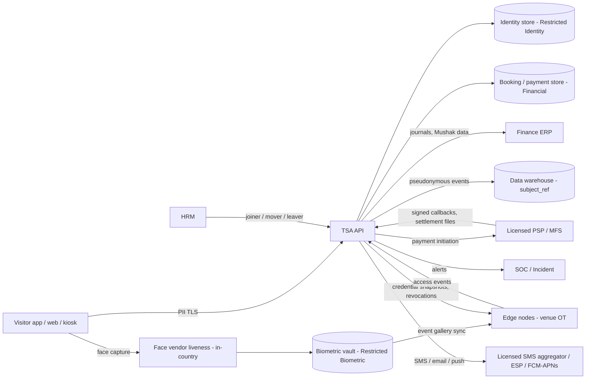

# 8. Security, privacy and legal

## 8.1 Control framework

The SRS §33.1 names ISO 27001, ISO 27701, SOC 2, OWASP Top 10 and PCI DSS. The versions below are the B12 baseline. Each version is to be re-confirmed at contract [VERIFY-VERSION].

| Standard | Use | Version |
|---|---|---|
| ISO/IEC 27001 | Vendor ISMS for development and hosting (SRS §33.1) | 2022 + Amd 1:2024 |
| ISO/IEC 27701 | Privacy information management (SRS §33.1) | 2025 |
| SOC 2 Type II | Cloud-hosted components (SRS §33.1) | AICPA TSC 2017 (rev. 2022 points of focus) |
| OWASP Top 10 | Web risk baseline, including A10 (§8.5) | 2025 |
| OWASP API Security Top 10 | API baseline (§7.1 TSA-API-011) | 2023 |
| OWASP ASVS | L2 everywhere; L3 for gate verification, payments, admin | 5.0 |
| OWASP MASVS | Visitor mobile app (§8.6) | 2.x |
| PCI DSS | Scope minimisation; SAQ per channel (D-15) | 4.0.1 |
| NIST SP 800-63B | Authenticator assurance (AAL2 staff; phishing-resistant for privileged) | SP 800-63B-4 |
| NIST SP 800-218 (SSDF) | Secure development practices (§12) | v1.1 |
| SLSA | Build provenance (§12) | v1.2 |
| ISO/IEC 30107-3 | Face presentation-attack detection | 2023 |
| ISO/IEC 19795-1 / 19795-10 | Biometric performance testing / demographic differentials | 19795-1:2021; 19795-10:2024 |
| NIST FRTE (formerly FRVT) | Independent face-algorithm evidence from the vendor | Latest report at bid date |
| TLS | 1.3 default; 1.2 floor (D-01) | RFC 9846 (TLS 1.3, B12 baseline; obsoletes RFC 8446) [VERIFY-VERSION] |
| WCAG | 2.2 AA target; 2.1 AA floor (D-02) | 2.2 |

## 8.2 Identity and access management (SRS §33.2)

| ID | Requirement | Class | Source |
|---|---|---|---|
| TSA-SEC-001 | MFA SHALL be enforced for all administrative, financial and SOC operator accounts. | SRS-SHALL | §33.2 |
| TSA-SEC-002 | Staff SSO SHALL use SAML 2.0 / OIDC against the enterprise IdP. | SRS-SHALL | §33.2 |
| TSA-SEC-003 | RBAC SHALL be enforced at UI and API layers with least-privilege defaults (§4). | SRS-SHALL | §33.2 |
| TSA-SEC-004 | Privileged activity SHALL be recorded. Access reviews SHALL be at least quarterly. | SRS-SHALL | §33.2 |
| TSA-SEC-005 | Session timeout, password complexity and lockout SHALL be configurable. Defaults: staff idle 15 min / absolute 12 h; gate console device-bound, idle 8 h; visitor refresh 30 d with rotation. | SRS-SHALL | §33.2 |
| TSA-SEC-006 | Privileged roles (MFA level L3, §4.1) SHALL use **phishing-resistant MFA** (FIDO2 / passkeys, AAL2+ per SP 800-63B-4). | DERIVED-MANDATORY | Parent §33.2 MFA; B12 |
| TSA-SEC-007 | Production administrative access SHALL go through **PAM** (just-in-time elevation, session recording, vaulted credentials). | DERIVED-MANDATORY | Parent §33.2 privileged activity recorded |
| TSA-SEC-008 | **Break-glass** accounts: sealed and dual-held; use ≤ 4 h; automatic SIEM alert; post-use review within 1 business day; credentials rotated after use. | DERIVED-MANDATORY | Parent §33.2 |
| TSA-SEC-009 | Step-up (re-authentication ≤ 5 min old) SHALL be required for overrides, blacklist approval, price / tax / GL approval, refund approval and PII reveal. | DERIVED-MANDATORY | Parent FR-ACC-008; §26.6 |
| TSA-SEC-010 | Customer authentication SHALL resist credential stuffing: rate limits, OTP throttling, breached-password screening where passwords exist, and passkeys preferred. | DERIVED-MANDATORY | Parent §33.5 |

## 8.3 Data classification (B12)

| Class | Examples | Handling |
|---|---|---|
| Public | Schedules, seat maps, product catalogue | Integrity controls |
| Internal | Configuration, inventory, outbox | Auth required; not public |
| Confidential PII | VISITOR, CONSENT, ATTENDEE, NOTIFICATION | Encrypted at rest; masked by default; purpose-bound |
| Restricted Identity | IDENTITY_DOCUMENT numbers | Field-level encryption, separate key, blind index; reveal needs R-17 approval |
| Restricted Biometric | Templates (vault), BIOMETRIC_PROFILE | Separate vault, segment and key; no raw images; DPIA; explicit consent |
| Restricted Security | ACCESS_EVENT, CREDENTIAL, BLACKLIST_*, ZONE / GATE / DEVICE config, AUDIT_EVENT | Security roles only; tamper-evident; SIEM |
| Restricted Financial | PAYMENT*, REFUND, LEDGER, TAX_DOCUMENT, GL, RECON | Finance roles; four-eyes; WORM exports |
| Secret | Signing keys, TOTP seeds, KMS keys, API secrets, webhook keys | HSM / KMS only; never logged; never exported; rotated |

## 8.4 Data protection and keys (SRS §33.3, §29.3)

| ID | Requirement | Class | Source |
|---|---|---|---|
| TSA-SEC-020 | Encryption at rest SHALL be AES-256 (or equivalent) for databases, files and backups. | SRS-SHALL | §33.3 |
| TSA-SEC-021 | Encryption in transit SHALL be TLS 1.2+ for all links, including edge and devices where feasible. | SRS-SHALL | §33.3 |
| TSA-SEC-022 | Field-level encryption with separate keys SHALL apply to document numbers and biometric references. | SRS-SHALL | §33.3; §29.3 |
| TSA-SEC-023 | Keys SHALL be held in an HSM or in-country cloud KMS. Rotation SHALL be documented. | SRS-SHALL | §33.3 |
| TSA-SEC-024 | **Separate keys per purpose:** identity-field, biometric-vault, credential-signing (per season; `key_id` in each credential), TOTP-seed wrapping, webhook signing, backup, audit hash-chain anchor. **Production keys SHALL never exist in UAT / test**; test environments use their own keys and synthetic data. | DERIVED-MANDATORY | Parent §33.3; B12 |
| TSA-SEC-025 | Logs, traces, analytics and problem responses SHALL NOT contain document numbers, OTPs, credential secrets, payment tokens or full mobile numbers. Canary scanning SHALL alert. | DERIVED-MANDATORY | Parent §27.1; §29.3 |
| TSA-SEC-026 | Analytics marts SHALL use the pseudonymous `subject_ref`. Re-identification requires R-17 approval. | DERIVED-MANDATORY | Parent §29.3; §29.4 |

## 8.5 OWASP Top 10:2025 mapping

| Category | TSA control | Test |
|---|---|---|
| A01 Broken Access Control | Object / property / function-level checks; subject from token; deny-by-default zones | TC-SEC-01 |
| A02 Security Misconfiguration | IaC baselines, CIS benchmarks, drift detection, security headers | TC-SEC-05 |
| A03 Software Supply Chain Failures | SBOM, SCA, signed artefacts, SLSA v1.2 provenance (§12) | TC-SEC-08 |
| A04 Cryptographic Failures | TLS, field encryption, per-purpose keys, signed credentials | TC-CRD-02, TC-CRD-06 |
| A05 Injection | Parameterised queries, schema validation (`additionalProperties: false`), output encoding | TC-SEC-05 |
| A06 Insecure Design | STRIDE threat model per flow; abuse cases (bots, replay, refund fraud, promo enumeration) | TC-WR-02, TC-PRM-01 |
| A07 Authentication Failures | MFA, phishing-resistant MFA for privileged, OTP throttling, device mTLS | TC-SEC-02 |
| A08 Software or Data Integrity Failures | Signed webhooks, signed edge snapshots, signed releases | TC-PAY-01, TC-SEC-08 |
| A09 Logging & Alerting Failures | SIEM, hash-chained audit, override-spike alerts | TC-SEC-04 |
| A10 Mishandling of Exceptional Conditions | **Entry is fail-closed:** exceptions, timeouts and malformed tokens → `DENY / POLICY_ERROR`. Unknown payment state is never shown as success. **Egress is hardware fail-safe**, never software-blocked (SRS §28.2). | TC-SEC-06 |

## 8.6 Application, mobile and infrastructure security (SRS §33.4–§33.7)

| ID | Requirement | Class | Source |
|---|---|---|---|
| TSA-SEC-030 | SAST and DAST SHALL run before each major release; SCA on every build. | SRS-SHALL | §33.4 |
| TSA-SEC-031 | **Network segments:** public DMZ / WAF; application (Tier 2); access-control core (Tier 1); venue OT (readers, controllers, edge, **kiosks**, POS); biometric vault; management / PAM; DR. Only explicit allow-listed flows (§11). | SRS-SHALL | §33.4 |
| TSA-SEC-032 | WAF and DDoS mitigation SHALL protect all public endpoints, including the waiting room. | SRS-SHALL | §33.4 |
| TSA-SEC-033 | Operator workstations and gate consoles SHALL have hardened baselines and endpoint protection. | SRS-SHALL | §33.4 |
| TSA-SEC-034 | **Mobile app:** tokens and the TOTP seed in Keychain / Android Keystore (hardware-backed where available); root / jailbreak and tamper detection (degraded mode, not lock-out, for ticket display); TLS certificate pinning with backup pins; screenshot blocking on credential screens where the OS permits; MASVS L2. | DERIVED-MANDATORY | Parent §33.4; §33.1; B12 |
| TSA-SEC-035 | SIEM SHALL aggregate logs with 24/7 monitoring and AI-assisted anomaly detection (access patterns, credential stuffing). | SRS-SHALL | §33.5 |
| TSA-SEC-036 | The cyber IRP SHALL include notification timelines "consistent with applicable law" — see §8.7. | SRS-SHALL | §33.5 |
| TSA-SEC-037 | Integrations SHALL pass a security review before production connection. Subcontractors and hosting locations SHALL be disclosed. | SRS-SHALL | §33.6 |
| TSA-SEC-038 | Independent penetration testing at least annually and after each major release; right-to-audit; responsible-disclosure channel. | SRS-SHALL | §33.7 |
| TSA-SEC-039 | **SEC-GOV-08:** a P1 register SHALL span SIT, UAT, pen test and load test. **No release, including go-live, SHALL proceed with an open P1.** P1 fixes SHALL be independently re-verified. This applies to **every** release, including hypercare and warranty patches (§12 gate G-P1). | SRS-SHALL | §33.7 SEC-GOV-08 |
| TSA-SEC-040 | Patching SHALL be at least quarterly. Actively exploited vulnerabilities SHALL be patched within 72 hours of vendor patch release. | SRS-SHALL | §32.3 |

## 8.7 Incident and breach notification (two-track)

| Track | Trigger | Recipient | Timeline | Tag |
|---|---|---|---|---|
| Cyber incident | Cyber security incident affecting SSCOS | National CERT (per Cyber Security Act 2026, Act No. 81) | **Immediately** on detection | `[LEGAL-VERIFY: CERT designation, form and channel]` |
| Personal-data breach | Breach affecting personal data | Regulator under PDPA 2026, and affected persons where required | Per PDPA 2026 | `[LEGAL-VERIFY: statutory deadline; PDPA ss.23 and 31–35 are not yet in force per B4 — confirm which notification duties apply now]` |
| Internal | Any S1 / S2 security incident or suspected breach | ABG CISO, DPO / CDO, Steering Committee | Initial within 1 h; full written report **≤ 72 h** (internal target, B12) | RECOMMENDED |

The payment-security track (PSP / Bangladesh Bank) applies only if card or MFS data is implicated `[LEGAL-VERIFY]`.

## 8.8 Bangladesh legal and regulatory baseline

**This is not legal advice.** Every fact below is the Part B (B4) baseline, recorded **as provided**, and tagged for ABG Legal confirmation before contract signature.

| Area | Baseline fact (B4) | Design response | Tag |
|---|---|---|---|
| Personal data | Personal Data Protection Act 2026, Act No. 63, dated 10 Apr 2026, deemed in force from 6 Nov 2025 except ss.23 and 31–35. Child = under 18. Biometric data is sensitive. Deletion propagates to all copies. Processing records kept ≥ 5 years. DSR rights; breach notification; a CDO function. | Consent per purpose (TSA-IDN-006); biometric explicit consent; GUARDIAN_LINK for under-18; DELETION_LEDGER covering all copies; RT-PRC ≥ 5 y; DSR console (SCR-BO-09); R-17 Privacy Officer / CDO; §8.7 | `[LEGAL-VERIFY]` |
| Data governance | National Data Management Act 2026 (Act No. 80) establishes the National Data Management Authority. | Data inventory / purpose register kept ready for Authority requests (§8.10) | `[LEGAL-VERIFY: obligations on private controllers]` |
| Cyber security | Cyber Security Act 2026 (Act No. 81): immediate notification to the national CERT. | §8.7 track 1; logs preserved | `[LEGAL-VERIFY]` |
| Residency | — | In-country hosting is an **SRS contractual requirement** (A-05); DR is also in-country. Cross-border processing only by approved exception (D-14). | SRS (A-05) |
| Payments | Payment and Settlement Systems Act 2024: PSP / PSO licensing. Bangladesh Bank warned the public in Sept 2026 about unlicensed aggregators. Card-not-present transactions need two-factor authentication (3-D Secure 2.x). | Licence verified at contract, go-live and annually (TSA-PAY-007); 3DS 2.x (TSA-PAY-006); no stored value (A-13) | `[LEGAL-VERIFY]` |
| Refunds | Bangladesh Bank 2023: refund within about 3 days, to the original instrument. Ticketing is carved out of escrow-until-delivery. | TSA-RFD-004 default ≤ 3 days, original instrument; no escrow flow | `[LEGAL-VERIFY: exact working-day count and carve-out wording]` |
| E-commerce | Digital Commerce Operation Guidelines 2021: complaint handling about 72 h; force-majeure refund about 72 h; records ≥ 6 years. Consumer Rights Protection Act 2009. | Complaint SLA in support (CXP); event-cancellation bulk refund (TSA-RFD-002); RT-FIN ≥ 6 y; VAT-inclusive price display | `[LEGAL-VERIFY]` |
| VAT | Standard rate 15 %; sports organisers reportedly 10 %. Mushak-6.3 tax invoice with gap-free serials; credit note (form number to confirm); data for the monthly Mushak-9.1 return; VAT records ≥ 5 years; EFD / SDC requirement to check. | Rates as TAX_CODE data, never hard-coded; gap-free serials (§5.4); credit notes; 9.1 extract; RT-VAT ≥ 5 y; EFD/SDC adapter (INT-14) | `[LEGAL-VERIFY: rate per product category; credit-note form number; EFD/SDC applicability]` |
| SMS | Delivered through a BTRC-compliant aggregator. | INT-11 via a licensed aggregator; masked sender ID; marketing only with consent | `[LEGAL-VERIFY]` |
| Accessibility | No specific Bangladesh digital-accessibility mandate assumed. | WCAG 2.1 AA floor (SRS), 2.2 AA target | `[LEGAL-VERIFY: Rights and Protection of Persons with Disabilities Act 2013 applicability]` |

## 8.9 Biometric governance

| ID | Requirement | Class | Source |
|---|---|---|---|
| TSA-PRV-001 | A DPIA SHALL be approved by the Privacy Officer / CDO before face mode is enabled at any gate. | DERIVED-MANDATORY | Parent §29.3; PDPA 2026 sensitive data `[LEGAL-VERIFY]` |
| TSA-PRV-002 | The face vendor SHALL be a contracted processor: no training on SSCOS data, in-country processing, deletion on instruction with evidence. | DERIVED-MANDATORY | Parent §33.6 |
| TSA-PRV-003 | Signage and the privacy notice SHALL be displayed at face lanes. A non-biometric lane SHALL exist at every entrance. | DERIVED-MANDATORY | Parent A-10 |
| TSA-PRV-004 | A supervised manual-check lane with female staff SHALL be available per SOP (CQ-23). | DERIVED-MANDATORY | Parent §1.2 |
| TSA-PRV-005 | Evidence SHALL include: ISO/IEC 30107-3 PAD test report; ISO/IEC 19795-1 scenario test on site; ISO/IEC 19795-10 demographic results; NIST FRTE results for the exact algorithm version. | DERIVED-MANDATORY | Parent §30.1 FRR / FAR |

## 8.10 Audit events, purpose register and data-flow map

**Audit events (AUDIT_EVENT, hash-chained, WORM, ≥ 12 months — §33.5):**
- Login, MFA, step-up and break-glass.
- Role / permission / API-client changes.
- Price, promo, tax and GL changes and approvals.
- Inventory kills / COMP.
- Allocation issuance.
- Refund raise / approve.
- Drawer variance sign-off.
- Zone / gate / device / zone-permission changes.
- Overrides and un-scans.
- Blacklist create / approve / remove.
- Face threshold changes.
- PII reveal; visitor merge; consent changes; DSR actions; deletion execution.
- Reconciliation exception resolution; journal export.
- Key rotation; configuration changes.
- Data exports.

**Purpose register (extract):**

| Purpose | Data | Lawful basis `[LEGAL-VERIFY]` | Retention |
|---|---|---|---|
| Ticket sale and entry | Identity, booking, credential, access events | Contract | RT-FIN / RT-ACC |
| Face express entry | Biometric template | Explicit consent | RT-BIO |
| Safety / blacklist | Watch-list subject, match log | Legitimate interest / legal obligation | RT-BL |
| VAT and finance | Tax documents, payments | Legal obligation | RT-VAT / RT-FIN |
| Marketing | Contact, preferences | Consent | Until withdrawn |
| Analytics | Pseudonymous `subject_ref` events | Legitimate interest | Mart policy |

## 8.11 Licence and fraud controls

| ID | Control | Class | Source |
|---|---|---|---|
| TSA-SEC-050 | A processor register listing PSP / PSO / SMS / face / hosting providers with licence evidence, checked at contract, go-live and annually. | DERIVED-MANDATORY | Parent PSS Act 2024 (B4) `[LEGAL-VERIFY]` |
| TSA-SEC-051 | Fraud rules: velocity per identity / instrument / device; promo enumeration limits; refund-to-original-instrument only; anomaly alerts on override, reissue and refund spikes. | DERIVED-MANDATORY | Parent §33.5 anomaly detection |
| TSA-SEC-052 | Ticket-resale abuse: purchase limits per verified identity; attendee naming for premium categories; credential re-binding audited. | DERIVED-MANDATORY | Parent FR-TCK-007 |

---

# 9. Non-functional requirements

## 9.1 Availability, continuity and tier per component

From SRS §32.1:
- Tier 1 — Life-Safety & Security: 99.95 %.
- Tier 2 — Core Transactional (including "Ticketing"): 99.9 %.
- Tier 3 — Supporting Services: 99.5 %.

Measurement is monthly, excluding "Pre-approved maintenance windows ≤ 4 hrs/month" (Tiers 1–2) or "≤ 6 hrs/month" (Tier 3).

**Allowed downtime per 30-day month** (43,200 minutes):
- Tier 1: 43,200 × 0.0005 = 21.6 min.
- Tier 2: 43,200 × 0.001 = 43.2 min.
- Tier 3: 43,200 × 0.005 = 216 min.

**RPO / RTO (SRS §32.4):**

| Tier | RPO | RTO |
|---|---|---|
| Tier 1 | ≤ 1 hour | ≤ 1 hour |
| Tier 2 | ≤ 15 minutes | ≤ 4 hours |
| Tier 3 | ≤ 24 hours | ≤ 24 hours |

**Tier per component.** Tier 1 means access control (D-09).

| Component | Tier |
|---|---|
| Verification service (E-26 and aliases), policy engine, edge nodes, revocation feed, blacklist / watch-list, override, gate console, face edge matching, access-event ingest | **Tier 1** |
| Visitor identity / registration, catalogue, availability, inventory / holds, waiting room, bookings, payments, provider webhooks, refunds, memberships, credential issuance and render bundle, notifications, box office, kiosk sale, corporate / sponsor allocation, tax documents, reconciliation and journal export, F&B payment / ledger API | **Tier 2** |
| KPI dashboards feed, marts, reports, audit query UI, developer portal | **Tier 3** |

Maintenance SHALL NOT be scheduled inside event windows (§9.3).

## 9.2 Performance and service targets (quoted exactly from the SRS)

| ID | Target (verbatim) | SRS source |
|---|---|---|
| TSA-NFR-001 | "(face/QR/RFID scan to turnstile release) shall complete in ≤ 1.5 seconds at the 95th percentile" | §3.1 |
| TSA-NFR-002 | "95th percentile response time ≤ 500 ms for read APIs; ≤ 1.5 s for access-control verification APIs" | §27.3 |
| TSA-NFR-003 | "Access-verification API shall sustain a minimum of 50 requests/second per gate cluster during peak ingress" | §27.3 |
| TSA-NFR-004 | "minimum of 100,000 registered visitor profiles and 20,000 concurrent app/portal sessions during peak events" | §3.1 |
| TSA-NFR-005 | Blacklist "deny/flag matches within 1 second" | FR-ACC-002 |
| TSA-NFR-006 | "Real-time identity match callback (≤ 1 second)" | §28.1 |
| TSA-NFR-007 | "Average gate transaction time (scan to turnstile open) ≤ 2 seconds" | §30.1 |
| TSA-NFR-008 | "False rejection rate (face recognition) ≤ 1%"; "False acceptance rate (face recognition) ≤ 0.1%" | §30.1 |
| TSA-NFR-009 | "Mean time to detect (MTTD) a security incident ≤ 30 seconds"; "Mean time to first responder dispatch ≤ 3 minutes" | §30.1 |
| TSA-NFR-010 | "Near-real-time refresh (≤ 5 minutes)" | §29.4 |
| TSA-NFR-011 | "Daily ticketing revenue reconciliation accuracy 100 % match to GL within 24 hours" | §30.2 |
| TSA-NFR-012 | "Online booking conversion rate ≥ 60 % of started bookings completed" | §30.2 |
| TSA-NFR-013 | "Membership renewal rate ≥ 75 % annual renewal" | §30.2 |
| TSA-NFR-014 | "escalation-to-human handoff time ≤ 60 seconds"; "first-contact resolution rate ≥ 70%" | §30.3 |
| TSA-NFR-015 | "All latency/throughput targets met at 120 % of projected peak load" | §31.1 |
| TSA-NFR-016 | "local buffering/replay for at least 30 minutes of data" | §28.2 |
| TSA-NFR-017 | Severity SLA: Critical (S1) "≤ 15 minutes, 24/7" response, "≤ 4 hours" resolution; High (S2) "≤ 30 minutes, 24/7" / "≤ 8 hours"; Medium (S3) "≤ 2 hours (business hours)" / "≤ 2 business days"; Low (S4) "≤ 1 business day" / "≤ 5 business days" | §32.2 |
| TSA-NFR-018 | "Quarterly security patching cadence at minimum, with emergency patching for actively exploited vulnerabilities within 72 hours of vendor patch release." | §32.3 |
| TSA-NFR-019 | "Backup verification (restore test) shall be performed and evidenced at least quarterly." | §32.3 |

**Derived latency budgets (DERIVED-MANDATORY, parent TSA-NFR-001):**
- **QR / RFID / NFC lane:** reader ≤ 300 + edge decision ≤ 300 + network ≤ 150 + actuation ≤ 500 + reserve 250 = 1,500 ms.
- **Face lane:** match callback ≤ 1,000 + policy ≤ 200 + actuation ≤ 300 = 1,500 ms. There is **no reserve**, so the face timeout falls back in-lane at 1 s (TSA-GAT-004).
- **Booking:** hold P95 ≤ 800 ms; payment initiation P95 ≤ 1.5 s.

## 9.3 Event-window SLOs, error budgets and change freeze

The **event window** runs from gates-open (default T − 2 h before kick-off) to kick-off + 30 min, so the default length is 120 + 30 = **150 min**.

| SLO | Target | Class | Parent |
|---|---|---|---|
| Gate decision latency | P95 ≤ 1.5 s (SRS); **P99 ≤ 3 s** | SRS-SHALL / RECOMMENDED (P99) | §3.1 |
| Gate correctness | 0 incorrect ALLOW | DERIVED-MANDATORY | FR-ACC-002/006 |
| Credential render success (app opens wallet → QR shown, including offline) | ≥ 99.9 % | RECOMMENDED | B11; FR-TCK-007 |
| Waiting-room admission-to-hold success | ≥ 99 % of admitted users obtain a hold or a definitive `SLOT_UNAVAILABLE` | RECOMMENDED | B11; §3.1 |
| Ingress queue time per entrance | P95 ≤ 10 min, measured by lane counters / CV (CQ-03) | RECOMMENDED | B11; §1.2 Visitor Experience |
| Blacklist deny + alert | ≤ 1 s (SRS) | SRS-SHALL | FR-ACC-002 |

**Error budget for an example Category A event:**
- Expected verifications = 40,000 entries × 1.3 retry factor = 52,000 (§9.4).
- At a 99.95 % "decided within 3 s" objective, the budget is 52,000 × 0.0005 = **26 slow or failed verifications per event**.

**Burn-rate alerting (multi-window):**
- **Page (S1) at burn rate ≥ 10×** over both a 5-min and a 1-min window. At 10× the whole budget is spent in 150 ÷ 10 = 15 min.
- **Ticket (S2) at ≥ 2×** over a 30-min window. At 2× the budget is spent in 150 ÷ 2 = 75 min.
- **Monthly Tier 1 budget:** 21.6 min of downtime. Alerts fire at 50 % (10.8 min) and 100 % consumed.

**Error-budget policy (RECOMMENDED):**
- **> 50 % of the monthly Tier 1 budget consumed:** non-reliability changes to Tier 1 components need CAB plus SOC Manager approval.
- **> 100 % consumed:** reliability fixes only until a postmortem is approved. Every S1 / S2 gets an RCA in the monthly SLA report (SRS §32.3).

**Change freeze:** **T − 48 h to T + 6 h** around every Category A event for all Tier 1 and Tier 2 production changes, except emergency security fixes (TSA-SEC-040) approved by CAB. It is enforced by the deployment pipeline (§12, CICD-011).

## 9.4 Capacity model (A-15 parameters; replace with ABG figures)

### 9.4.1 Digital channels

| Parameter | Value | Source |
|---|---|---|
| Peak concurrent sessions | 20,000 | SRS §3.1 |
| Acceptance peak | 20,000 × 1.2 = **24,000** | SRS §31.1 |
| Think time | 10 s | A-15 |
| Steady request rate | 24,000 ÷ 10 = **2,400 req/s** | derived |
| On-sale burst factor | 2 | A-15 |
| Design request rate | 2,400 × 2 = **4,800 req/s** | derived |
| Waiting-room admission R | 50 users/s | A-15 |
| Holds | 50 × 0.8 = **40/s** | A-15 share 0.8 |
| Orders | 40 × 0.6 = **24/s** | SRS §30.2 conversion |
| Tickets / credentials | 24 × 2.5 = **60/s** | A-15 tickets per order |
| Payment initiations | 40 × 1.2 = **48/s** | A-15 retry factor |
| Provider callbacks | 48 × 2 = **96/s** | A-15 |
| Notifications | 24 × 3 = **72/s** (SMS 24/s) | derived |
| At 120 % | holds 48/s; orders 28.8/s; tickets 72/s; callbacks 115.2/s | × 1.2 |

### 9.4.2 Gate ingress and lane model

| Parameter | Value | Source |
|---|---|---|
| Venue capacity C | 40,000 | A-15 / CQ-03 |
| Share arriving in final 60 min | 60 % → 40,000 × 0.6 = **24,000/h** | A-15 |
| Entry rate | 24,000 ÷ 3,600 = **6.67/s** | derived |
| Verification requests | 6.67 × 1.3 = **8.67 req/s** | A-15 retry factor |
| Largest cluster (35 %) | 8.67 × 0.35 = **3.03 req/s** | A-15 |
| Headroom vs SRS 50 req/s | 50 ÷ 3.03 = **16.5×** | derived |
| Lane throughput | 3 s/person → 3,600 ÷ 3 = 1,200/h | A-15 |
| Minimum lanes | 24,000 ÷ 1,200 = **20** | derived |
| With 25 % fallback headroom | 20 × 1.25 = **25 lanes** | derived |
| Largest cluster | 24,000 × 0.35 = 8,400/h ÷ 1,200 = 7; × 1.25 = 8.75 → **9 lanes** | derived |
| Lane mix (per cluster, RECOMMENDED) | ≥ 1 face express lane where DPIA approved; ≥ 1 accessible lane; ≥ 1 manual / supervised lane; the rest QR / NFC / RFID | A-10; §26.6 |
| Face lane throughput | Assumes 2 s/person → 1,800/h `[VENDOR-DOC-REQUIRED]` | A-15 |

### 9.4.3 Edge sizing

| Item | Value |
|---|---|
| Face gallery | 40,000 × 0.3 opt-in = **12,000 templates**; × 2 KB = **24 MB** `[VENDOR-DOC-REQUIRED: template size]` |
| Edge buffer (largest cluster, 4 h design ≥ SRS 30 min) | 8,400 × 1.3 = 10,920 events/h; × 4 = **43,680 events**; × 1 KB ≈ **43.7 MB** |

### 9.4.4 Storage (annual)

| Item | Arithmetic | Result |
|---|---|---|
| Tickets / year | A-15 | 2,000,000 |
| Bookings / year | 2,000,000 ÷ 2.5 | 800,000 |
| Booking data | 800,000 × 4 KB | 3.2 GB |
| Access events | (2,000,000 × 2) + (10,000 members × 150 visits × 2) = 4,000,000 + 3,000,000 | 7,000,000 events × 1 KB = 7.0 GB/yr; 13-month retention 7.0 × 13 ÷ 12 ≈ **7.6 GB** |
| Audit | 20,000,000 × 0.5 KB | **10 GB/yr** |

## 9.5 Measurement rules

| Metric | Method |
|---|---|
| Gate P95 / P99 | From reader scan event to turnstile release signal (or decision display for DENY), on the edge clock (NTP / PTP, skew ≤ 10 ms). Includes DENY. |
| Average gate transaction | Mean over ALLOW transactions in the period |
| Read API P95 | At the API gateway, per endpoint per 5-min window |
| Verification throughput | 15 min sustained at 120 % with zero incorrect ALLOW and error < 0.1 % |
| Uptime | Synthetic probes every 60 s from 2 locations; a minute is down if both fail |
| Credential render | App telemetry `wallet.render.ok` ÷ `wallet.render.attempt` (offline events queued) |
| Queue time | Lane entry counter / CV timestamps; P95 per entrance per 5 min |

## 9.6 KPI catalogue

| KPI | Formula | Source event | Dashboard (screen) | Owner | Target |
|---|---|---|---|---|---|
| Average gate transaction time | mean(release_ts − scan_ts) for ALLOW | `access.decision` | Security (SCR-CCC-01) | SOC Manager | ≤ 2 s (§30.1) |
| Gate P95 / P99 | percentile(latency_ms) | `access.decision` | Security | SOC Manager | 1.5 s / 3 s |
| Face FRR | genuine rejects ÷ genuine attempts | `access.decision` method FACE + fallback tag | Security | Security Admin | ≤ 1 % |
| Face FAR | false accepts ÷ impostor attempts (PoC / audit sampling) | Test harness / audit sample | Security | Security Admin | ≤ 0.1 % |
| MTTD (access) | mean(alert_ts − event_ts) | `access.alert.raised` | Security | SOC Manager | ≤ 30 s |
| Dispatch time | mean(dispatch_ts − alert_ts) | Incident module | Incident console (Other) | SOC Manager | ≤ 3 min |
| Blacklist alerts | count by gate / severity | `access.alert.raised` | Security | SOC Manager | Monitored |
| Override rate | overrides ÷ decisions | `access.override.recorded` | Security | SOC Manager | Alert > 0.5 % |
| Occupancy | Σ IN − Σ OUT per zone | `access.decision` | Executive (SCR-CCC-03) | Operations | Real time |
| Revenue by sport / event / channel / method | Σ net amount | `payment.captured` − refunds | Revenue (SCR-CCC-02) | Finance Controller | Target vs actual |
| Online booking conversion | confirmed ÷ started (HOLD created) | `booking.*` | Revenue | Ticket Admin | ≥ 60 % |
| Payment success rate | captured ÷ initiated per provider | `payment.*` | Revenue | Finance Analyst | Alert < 90 % |
| Membership renewal rate | renewed ÷ due in period | `membership.state_changed` | Revenue | Ticket Admin | ≥ 75 % |
| Reconciliation match | matched ÷ items; days with zero variance | `reconciliation.batch.completed` | Revenue | Finance Controller | 100 % within 24 h |
| Refund SLA | refunds completed ≤ SLA ÷ refunds | `payment.refunded` | Revenue | Finance Controller | ≥ 95 % `[LEGAL-VERIFY SLA]` |
| Credential render success | §9.5 | App telemetry | Executive | Ticket Admin | ≥ 99.9 % |
| Waiting-room admission-to-hold | holds ÷ admitted | `waiting_room.*` | Revenue | Ticket Admin | ≥ 99 % |
| Concierge handoff / FCR | mean handoff time; resolved first contact ÷ contacts | CXP module | CX (Other) | CX Lead | ≤ 60 s / ≥ 70 % |

Dashboards refresh ≤ 5 min (§29.4). Every figure is traceable to source records (§29.3 lineage).

## 9.7 Other NFRs

| ID | Requirement | Class | Source |
|---|---|---|---|
| TSA-NFR-020 | Bengali and English on all visitor-facing screens, switchable at any point; Bengali digits and lakh / crore grouping configurable. | SRS-SHALL | §26.6; FR-CXP-004 |
| TSA-NFR-021 | WCAG 2.1 AA floor on **all** screens, 2.2 AA target. | SRS-SHALL | §26.6 |
| TSA-NFR-022 | Operator consoles in dark and light modes. | SRS-SHALL | §26.6 |
| TSA-NFR-023 | Responsive across desktop, tablet and video-wall. | SRS-SHALL | §26.6 |
| TSA-NFR-024 | OpenTelemetry traces / metrics / logs; RED / USE dashboards; SLO burn-rate alerts (§9.3). | DERIVED-MANDATORY | Parent §32.3 SLA reports |
| TSA-NFR-025 | Data-quality rules enforced at ingestion. | SRS-SHALL | §29.2 |
| TSA-NFR-026 | Lineage traceable from dashboard figure to source records. | SRS-SHALL | §29.3 |
| TSA-NFR-027 | 24/7/365 support for S1 / S2; a technical account manager for the first 12 months; monthly SLA reports with RCA for S1 / S2. | SRS-SHALL | §32.3 |
