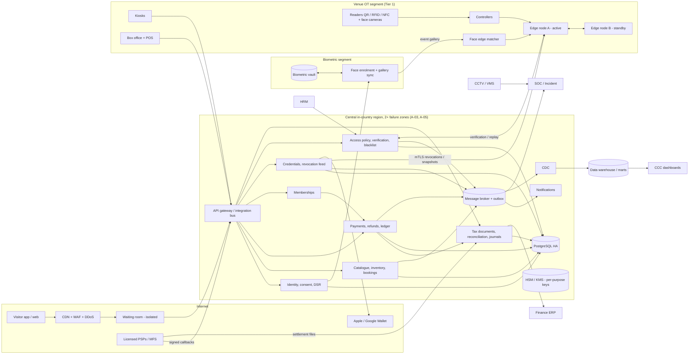

# 10. Integrations

## 10.1 Integration catalogue

The model is hub-and-spoke via the Integration Bus / API Gateway (SRS §28). Every row needs a **security review before production connection** (SRS §33.6), gate G-INT in §12.

Provider-specific endpoints, payloads, signatures and timeouts are `[VENDOR-DOC-REQUIRED]`. **No vendor API behaviour is assumed.**

**Column abbreviations:**
- **Dir** — direction: In / Out / Bi.
- **Idem** — idempotency mechanism.
- **Sandbox** — Y = vendor sandbox required; Sim = TSA-built simulator.
- **Review** — security-review evidence required before go-live: TM = threat model, PT = pen test of the interface, DPA = data processing agreement, LIC = licence check.

| ID | System | Purpose | Dir | Protocol | Auth | Data | Idem | Failure mode | Sandbox | Review | SRS |
|---|---|---|---|---|---|---|---|---|---|---|---|
| INT-01 | Face recognition platform | Enrolment with liveness; 1:N match at edge; watch-list | Bi | Vendor SDK at edge; enrolment API centrally | mTLS + client credentials | Template refs, match scores (no raw images retained) | Enrolment ID | Timeout > 1 s → in-lane fallback; breaker → credential-only | Y | TM, PT, DPA | §28.1; FR-ACC-001 |
| INT-02 | Biometric vault ↔ edge gallery sync | Event-scoped gallery distribution and purge | Out | Signed snapshot + delta over mTLS | Edge certificate | Encrypted templates, subject refs | Snapshot version | Stale > MAX_STALE → RESTRICTED (§11.3) | Sim | TM | §29.3 |
| INT-03 | CCTV / VMS | Camera reference on access alerts | In (reference) | ONVIF Profile S/T metadata; camera-to-gate map | Service account | Camera ID, timestamp | Alert ID | Missing camera → alert still sent with gate location | Sim | TM | §28.1; UC-SEC-01 |
| INT-04 | Turnstile controllers and readers | Scan → decision → actuation | Bi | Reader → controller via OSDP v2 Secure Channel (preferred); controller → edge via vendor API | OSDP SCBK; controller certificate | Token / UID, OPEN / HOLD_CLOSED, door-forced, tailgate events | `scanId` | Controller loss → lane offline + alarm; **egress hardware fail-safe** | Y | TM, PT | §28.1; §28.2 |
| INT-05 | RFID / NFC lifecycle | Issue / suspend / revoke cards | Bi | Reader SDK; lifecycle events | Device certificate | Card UID + crypto-auth keys (diversified) | Credential ID + version | Lag → edge revocation feed authoritative | Y | TM | §28.1 |
| INT-06 | Apple Wallet / Google Wallet | NFC / QR passes in wallets | Out (+ pass update callbacks) | PassKit web service; Google Wallet API | Pass signing certificate; service account | Pass serial, barcode / NFC payload (no PII beyond name) | Pass serial + version | Pass update failure → in-app credential remains valid | Y | TM, DPA; Apple NFC entitlement approval `[VENDOR-DOC-REQUIRED]` | §28.1 (NFC); FR-TCK-007 |
| INT-07 | Card aggregator / internet banking | Online payments, 3DS, refunds, settlement | Bi | REST + signed webhooks; settlement via SFTP / API | API keys / mTLS; webhook signature | Amount, provider ref, masked card | Idempotency key; provider event ID | Unknown → status query; never success without verification | Y | TM, PT, LIC, PCI AoC | §28.1 |
| INT-08 | MFS: bKash, Nagad, Rocket (direct or via aggregator) | Wallet payments, tokenised agreements, refunds | Bi | REST + callbacks; settlement reports | Per provider `[VENDOR-DOC-REQUIRED]` | MSISDN (masked), amount, refs | As INT-07 | As INT-07 | Y | TM, PT, LIC | §28.1; UC-TCK-01 step 4 |
| INT-09 | Card-present POS terminals | Box office / kiosk card sales | Bi | Terminal SDK / semi-integrated (P2PE) | Terminal pairing | Amount, approval code, masked PAN only | Terminal txn ID | Terminal down → other terminal or cash | Y | PCI P2PE listing, LIC | §33.1 |
| INT-10 | Cash management | Drawer float, counts, deposit | In (internal) | Box-office UI + bank deposit file (optional) | Staff SSO | Counts, variances | Shift + drawer ID | Manual count with supervisor sign-off | Sim | TM | FR-TCK-010 |
| INT-11 | SMS aggregator (BTRC-compliant) | Transactional SMS, OTP | Out + receipts | REST; delivery-receipt callbacks | API key + IP allow-list; callback signature | Mobile, short template (first name, booking ref) | Message ID | Retry; fail-over aggregator; never rolls back a ticket | Y | TM, DPA, LIC `[LEGAL-VERIFY]` | §28.1 |
| INT-12 | Email service | Confirmations, invoices (signed expiring links) | Out + bounces | SMTP / API; bounce webhooks; **SPF, DKIM, DMARC (p=quarantine → reject)** | API key | Email, template data | Message ID | Retry; suppression list | Y | TM, DPA | §28.1 |
| INT-13 | Push (FCM / APNs) | Booking, credential, safety alerts | Out | Provider APIs | Service credentials | Device token, short text (no PII) | Notification ID | Best-effort; in-app inbox is the source | Y | TM | §28.1 |
| INT-14 | VAT / NBR EFD–SDC (if required) | Fiscal registration of invoices | Out | Device / adapter `[VENDOR-DOC-REQUIRED]` | Per NBR spec `[LEGAL-VERIFY]` | Invoice data | Invoice serial | Store-and-forward; continuity check | Y | TM `[LEGAL-VERIFY]` | FR-FIN-002 |
| INT-15 | Finance ERP (GL, AR, VAT register) | Journals, AR invoices, Mushak data, settlements | Out + ack | ERP API or file; `/finance/vouchers` pull | Service client mTLS | Journal lines (no PII), AR customer refs | `journal_key` | Queue + exception; no duplicate posting | Y | TM | §28.1; FR-TCK-010; FR-FIN-001/002 |
| INT-16 | HRM | Employee master; joiner / mover / leaver | In | Events + master read API | Service client | Employee ref, department, zone roles | Event ID | Leaver SLA alarm (TSA-ZON-004) | Sim | TM | §29.2; FR-HRM-001 |
| INT-17 | Vendor & Partner module | Vendor staff refs; F&B settlement legs | Bi | Events / API | Service client | Contact refs; amounts | Event ID | — | Sim | TM | §29.2; FR-FNB-006 |
| INT-18 | Incident module / SOC | Alerts, incidents, escalation | Out | `POST /incidents`, `/incidents/{id}/escalate`; `access.alert.raised` | Service client | Alert, gate, zone, camera ref, masked subject | Alert ID | Broker retry; SOC console polling fallback | Sim | TM | §27.2; FR-SOC-005 |
| INT-19 | Command & Control Center | KPI and panel feeds | Out | `/dashboards/kpi`; events | Service client | Aggregates | — | Tier 3 | Sim | TM | FR-CCC-001/003/004/005 |
| INT-20 | Data warehouse / BI / AI Copilot | Curated, permission-tagged marts | Out | CDC → marts | Service account | Pseudonymous events (`subject_ref`) | LSN / offset | Freshness alarm > 5 min | Sim | TM, DPIA | §29.4; FR-BI-002/003 |
| INT-21 | F&B ordering module | Shared payments and ledger | In (calls TSA) | E-16, E-46, E-47 | Service client mTLS, narrow scope | Order refs, amounts | Idempotency key; source_ref | Tier 2 | Sim | TM | FR-FNB-005/006 |
| INT-22 | Sports module | Team / academy rosters | In | Events / API | Service client | Roster refs, schedules | Event ID | — | Sim | TM | FR-ACC-006; FR-SPT-003 |
| INT-23 | Event & Sponsor module | Sponsor package inventory | In | API | Service client | Package refs, quantities | Package version | — | Sim | TM | FR-EVT-002/003 |
| INT-24 | AI Concierge platform | Ticket intents, human handoff | Bi | Tool APIs scoped to the token subject | OAuth token exchange | Booking summary (own only) | Request ID | Human handoff | Y | TM, DPA | FR-CXP-001/003 |
| INT-25 | Parking module (roadmap consumer) | Booking events | Out | Webhook `booking.confirmed` | Signed webhook | Booking / event IDs | Event ID | — | Sim | TM | FR-PRK-003 (Should) |
| INT-26 | Fire alarm system | None (hard-wired egress) | — | Hardware | — | — | — | Egress released independently of software | — | Life-safety sign-off | §28.1; §28.2 |
| INT-27 | Enterprise IdP | Staff SSO / MFA | In | SAML 2.0 / OIDC | Federation metadata | Staff identity, groups | — | Break-glass (TSA-SEC-008) | Y | TM | §33.2 |
| INT-28 | CDN / WAF / waiting-room provider | Edge protection and queueing | Bi | Provider config + signed admission tokens | Provider keys | Queue tokens (no PII) | Token ID | Fail-closed to queue page; core stays isolated | Y | TM, PT | §33.4 |

Indoor positioning, weather, ride-hailing, IoT and power integrations (§28.1) have **no TSA dependency**.

## 10.2 Payment connector contract and conformance suite

Every payment connector (INT-07, INT-08, INT-09, INT-10) SHALL implement:

```text
initiate(payable, amount, method, interaction, returnUri?, idempotencyKey) -> {providerRef, action}
verifyWebhook(headers, rawBody) -> {valid, providerEventId, providerRef, status, amount}
queryStatus(providerRef) -> {status, amount, capturedAt}
refund(providerRef, amount, refundKey) -> {providerRefundRef, status}
refundStatus(providerRefundRef) -> {status}
parseSettlement(file) -> [{providerRef, gross, fee, net, settledAt}]
```

The conformance suite (TC-PAY-05…TC-PAY-08) proves the following per connector:
- success, decline and user cancel;
- timeout → PENDING → status query;
- duplicate, out-of-order and forged webhooks;
- amount mismatch;
- full and partial refunds, and a refund retried with the same key;
- late capture;
- a settlement file containing an unknown reference.

## 10.3 Sequence — UC-TCK-01 (purchase and access)

```mermaid
sequenceDiagram
  autonumber
  actor V as Visitor
  participant APP as App / Web / Kiosk
  participant API as TSA API
  participant DB as TSA DB
  participant PSP as Licensed PSP / MFS
  participant NTF as Notifications
  participant EDGE as Edge node
  participant CTRL as Controller + reader
  V->>APP: select sport and slot (step 1)
  APP->>API: GET /availability (step 2)
  API-->>APP: availability + price
  APP->>API: POST /bookings + Idempotency-Key (step 3)
  API->>DB: conditional UPDATE unit → HELD; booking HOLD
  API-->>APP: 201 booking, holdExpiresAt
  APP->>API: POST /payments (interaction REDIRECT, returnUri)
  API->>PSP: initiate (step 4)
  PSP-->>V: provider checkout (3DS / MFS PIN)
  alt 3a payment fails
    PSP->>API: signed webhook FAILED
    API->>DB: booking PAYMENT_FAILED_RETRY_HOLD; expiry = min(failure + 10 min, ceiling)
    API-->>APP: prompt retry
  else captured
    PSP->>API: signed webhook CAPTURED
    API->>DB: PROVIDER_EVENT dedupe; CONFIRMED; TICKET per ATTENDEE; CREDENTIALs; Mushak-6.3; outbox
    API->>NTF: SMS + email + push (step 5)
  end
  Note over EDGE: revocation feed ≤ 15 s; snapshots (entitlements, blacklist, gallery, policy)
  V->>CTRL: present QR / NFC / RFID or face (step 6)
  CTRL->>EDGE: verification request (gateId, deviceId, scanId, direction)
  EDGE->>EDGE: signature, status, window, zone, blacklist, re-entry, capacity (step 7)
  alt 7a blacklist match
    EDGE-->>CTRL: DENY HOLD_CLOSED (generic message)
    EDGE->>API: access.alert.raised → SOC (UC-SEC-01)
  else 7b expired / slot mismatch
    EDGE-->>CTRL: DENY, direct to help desk / AI concierge
  else valid
    EDGE-->>CTRL: ALLOW OPEN (step 8)
  end
  EDGE->>API: ACCESS_EVENT (decisionId, latency)
```

## 10.4 Sequence — UC-SEC-01 (unauthorised access)

```mermaid
sequenceDiagram
  autonumber
  actor P as Individual
  participant EDGE as Edge / access engine
  participant SOC as SOC dashboard
  participant OP as Security Operator
  participant FT as Field team
  participant INC as Incident module
  participant DM as Duty manager
  P->>EDGE: present face / QR / RFID / NFC (1–2)
  EDGE->>EDGE: zone permission + blacklist (3)
  EDGE->>EDGE: not authorised for zone (4)
  alt 4a recognised VIP without zone access
    EDGE->>SOC: override prompt
    OP->>EDGE: POST /access/overrides (reason, step-up)
  else deny
    EDGE-->>P: DENY (5)
    EDGE->>SOC: alert + gate + camera reference (5)
    SOC->>INC: POST /incidents
    OP->>FT: dispatch nearest team (6)
    alt 6a no acknowledgement within 3 min
      SOC->>INC: POST /incidents/{id}/escalate
      INC->>DM: notify
    end
    FT->>INC: log outcome (7)
  end
  Note over SOC,INC: Denial + resolution logged; blacklist updated by four-eyes if a new threat
```

---

# 11. Deployment, edge, DR and backup

## 11.1 Architecture



**Topology rules:**
- Readers connect only to controllers, and controllers only to the edge.
- Kiosks and POS sit in the venue segment and reach central only via the gateway, using device certificates.
- The biometric vault is reachable only from the face service.

## 11.2 Deployment option analysis

The SRS requires in-country hosting (A-05). Final choice: CQ-02.

| Option | Description | Pros | Cons | Fit |
|---|---|---|---|---|
| O-1 ABG on-premises data centre + venue edge | Central services in an ABG-owned DC; DR in a second in-country DC | Full control; residency simple | Capex; ABG must run 24/7 ops; slower elasticity for on-sales | Viable if ABG has Tier III DCs |
| O-2 In-country cloud region + venue edge | Central on an in-country cloud / sovereign provider with ≥ 2 zones | Elastic for 24,000-session on-sales; managed KMS / DB; SOC 2 coverage | Provider availability in-country `[VERIFY]`; SOC 2 / 27001 evidence needed | **Recommended if an eligible in-country provider exists** |
| O-3 Hybrid | Tier 1 access control + biometric vault on-premises; Tier 2 / 3 in an in-country cloud | Life-safety under ABG control; elastic commerce | Two operating models; more integration | **Recommended default** (balances Tier 1 control and on-sale elasticity) |

In every option, venue edges keep gates running through any WAN or central outage (§11.3).

## 11.3 Edge modes and parameters

| ID | Requirement | Class | Source |
|---|---|---|---|
| TSA-EDG-001 | Each gate cluster SHALL have 2 edge nodes (active / standby) holding signed snapshots of entitlements, revocations, blacklist, gallery, policy and public keys. Every snapshot / delta is signed centrally and verified before apply. | DERIVED-MANDATORY | Parent §3.1 local failover; Tier 1 |
| TSA-EDG-002 | Modes (§6.10): **ONLINE** → **OFFLINE_CONTROLLED** (central unreachable: the edge decides locally with signed data) → **RESTRICTED** (revocation snapshot age > MAX_STALE = 10 min) → **REPLAYING** → ONLINE. In RESTRICTED, **high-risk cases fail closed**: VVIP / restricted-zone first entries, blacklist-sensitive zones and staff-only zones are denied to the manual lane. Standard entries continue with a SOC banner. | DERIVED-MANDATORY | Parent §3.1; FR-ACC-002 |
| TSA-EDG-003 | Offline anti-passback: hard for high-risk gates, soft elsewhere. Conflicts (same credential at two edges) are flagged `OFFLINE_CONFLICT` on replay for SOC review. | DERIVED-MANDATORY | Parent FR-ACC-006/007 |
| TSA-EDG-004 | Buffer ≥ 4 h of events (SRS ≥ 30 min); ordered replay with `edgeSeq`, deduplicated on `(deviceId, scanId)`. | SRS-SHALL | §28.2 |
| TSA-EDG-005 | Revocation freshness: ≤ 15 s online for revocations and blacklist; ≤ 60 s for entitlements. Revocation age is shown on the gate console. | DERIVED-MANDATORY | Parent FR-ACC-002 |
| TSA-EDG-006 | Clocks: NTP from 2 sources (PTP where supported); skew alarm > 100 ms. Edge secrets in TPM / HSM, wiped on decommission. | DERIVED-MANDATORY | Parent §9.5 measurement; §33.3 |

## 11.4 Disaster recovery

| ID | Requirement | Class | Source |
|---|---|---|---|
| TSA-DR-001 | RPO / RTO: Tier 1 ≤ 1 h / ≤ 1 h; Tier 2 ≤ 15 min / ≤ 4 h; Tier 3 ≤ 24 h / ≤ 24 h. | SRS-SHALL | §32.4 |
| TSA-DR-002 | The DR site SHALL be in-country, with asynchronous replication and a lag alarm at 5 min (15 ÷ 5 = 3× margin to the Tier 2 RPO). | DERIVED-MANDATORY | Parent §32.4; A-05 |
| TSA-DR-003 | Failover SHALL use DNS / global load-balancer and API-gateway failover with health-checked automation. Runbook target: Tier 2 back in ≤ 4 h. | DERIVED-MANDATORY | Parent §32.4 |
| TSA-DR-004 | During central failover, edges continue in OFFLINE_CONTROLLED, so gates are not interrupted. | DERIVED-MANDATORY | Parent §3.1 |
| TSA-DR-005 | After failover: a provider status-query sweep for all INITIATED / PENDING payments of the last 24 h; provider webhook retries accepted; a tax-serial continuity check before invoicing resumes. | DERIVED-MANDATORY | Parent §28.1; FR-FIN-002 |
| TSA-DR-006 | A **full DR exercise at least twice a year** (one outside event season, one before the season), with evidence and RCA. | DERIVED-MANDATORY | Parent §32.4; B14 |
| TSA-DR-007 | Restore tests at least quarterly, evidenced. | SRS-SHALL | §32.3 |

## 11.5 Backup

| ID | Requirement | Class | Source |
|---|---|---|---|
| TSA-BKP-001 | Backups SHALL be encrypted (AES-256) with a dedicated backup key. | SRS-SHALL | §33.3 |
| TSA-BKP-002 | Backups SHALL be **immutable** (object lock) for 35 days, with a copy **logically air-gapped** in a separate account / tenancy using **separate credentials** (no production admin can delete). | DERIVED-MANDATORY | Parent §32.4; ransomware resilience |
| TSA-BKP-003 | PostgreSQL PITR SHALL be ≤ 15 min (Tier 2 RPO). Tax-serial counters are included. | DERIVED-MANDATORY | Parent §32.4 |
| TSA-BKP-004 | Backup scope SHALL include IaC, configuration, policy and key metadata (not key material), so the environment can be rebuilt. | DERIVED-MANDATORY | Parent §32.4 |
| TSA-BKP-005 | After any restore, the DELETION_LEDGER SHALL be replayed before data is used. | DERIVED-MANDATORY | Parent §29.3; PDPA 2026 `[LEGAL-VERIFY]` |

---

# 12. CI/CD and supply chain

## 12.1 Pipeline (order is mandatory)

```mermaid
flowchart LR
  A[Commit: signed, pre-commit secret scan] --> B[Hermetic build]
  B --> C[Unit + contract tests: OpenAPI / JSON Schema]
  C --> D[SAST]
  D --> E[SCA + licence policy]
  E --> F[Secret + IaC + container scans]
  F --> G[SBOM CycloneDX / SPDX]
  G --> H[Sign artefacts + SLSA v1.2 provenance]
  H --> I[Deploy SIT: integration + PII-in-logs canary]
  I --> J[DAST + API fuzz]
  J --> K[Performance / resilience: major releases]
  K --> L[UAT]
  L --> M{G-P1: zero open P1}
  M --> N{Change-freeze window check}
  N --> O[CAB approval]
  O --> P[Admission: signature + provenance verify]
  P --> Q[Canary / blue-green]
  Q --> R[Post-deploy verification + SLO watch]
  R -->|burn-rate breach| S[Automatic rollback]
```



## 12.2 Requirements

| ID | Requirement | Class | Source |
|---|---|---|---|
| TSA-CICD-001 | Every merge SHALL run unit, contract, SAST, SCA, secret, IaC and container scans and the PII-in-logs linter. | SRS-SHALL (SAST / SCA) + DERIVED | §33.4 |
| TSA-CICD-002 | Each build SHALL produce an SBOM (CycloneDX 1.6 or SPDX [VERIFY-VERSION]) stored with the release. | DERIVED-MANDATORY | Parent §33.6 |
| TSA-CICD-003 | Provenance SHALL meet **SLSA v1.2** Build L3. Artefacts and images SHALL be signed and verified at deploy admission. | DERIVED-MANDATORY | Parent §33.6; B15 |
| TSA-CICD-004 | DAST and API fuzzing SHALL run before each major release. | SRS-SHALL | §33.4 |
| TSA-CICD-005 | **Gate G-P1 (SEC-GOV-08):** no release — including go-live, hypercare and warranty patches — proceeds with an open P1. P1 fixes are independently re-verified. Critical / High findings need an approved, time-bound exception. | SRS-SHALL | §33.7 |
| TSA-CICD-006 | Progressive delivery (canary / blue-green) with automated rollback on SLO burn. Edge releases go to one lane cluster first, outside event windows. | DERIVED-MANDATORY | Parent §31.1 rollback plan |
| TSA-CICD-007 | Database migrations SHALL follow expand / contract, be backward compatible for one release, and have rehearsed rollback. | DERIVED-MANDATORY | Parent §27.3 |
| TSA-CICD-008 | Environments: dev, SIT, UAT / sandbox (synthetic data, separate keys), performance, production, DR. | SRS-SHALL | §27.3 |
| TSA-CICD-009 | Secrets SHALL be in a vault with short-lived credentials. No secrets in repositories or images. | DERIVED-MANDATORY | Parent §33.3 |
| TSA-CICD-010 | Mobile third-party SDKs (payment, face, wallet) SHALL be pinned, in the SBOM and reviewed. | DERIVED-MANDATORY | Parent §33.6 |
| TSA-CICD-011 | **Change-freeze enforcement:** the pipeline SHALL block Tier 1 / Tier 2 production deploys from T − 48 h to T + 6 h of any Category A event (calendar from the Event module), except CAB-approved emergency security fixes. | DERIVED-MANDATORY | Parent §32.1 Tier 1; B11 / B15 |
| TSA-CICD-012 | Practices SHALL map to NIST SSDF SP 800-218 v1.1 (PO / PS / PW / RV), with evidence per release. | DERIVED-MANDATORY | Parent §33.4; B12 |
| TSA-CICD-013 | Gate G-INT: no new integration reaches production without its §10.1 security-review evidence. | SRS-SHALL | §33.6 |
