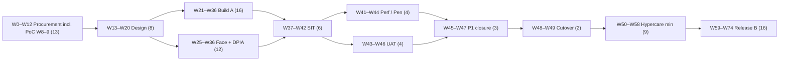

# 15. Deliverables, roadmap, PoC scenarios and procurement artefacts

## 15.1 Deliverables

| # | Deliverable | Gate | Owner |
|---|---|---|---|
| DL-01 | Solution Design Document mapped to the SRS six-layer architecture (§3) and this spec | Design Acceptance | Vendor SA |
| DL-02 | OpenAPI 3.1 specification and JSON Schemas (2020-12) for all §7.4 endpoints, including aliases | Design Acceptance | Vendor SA |
| DL-03 | Physical data model (DDL with §5.4 constraints), data dictionary and migration scripts | Design Acceptance | Vendor DBA |
| DL-04 | Threat model (STRIDE per flow, abuse cases) | Design Acceptance | Vendor Security |
| DL-05 | Biometric DPIA | Design Acceptance (before any face lane) | Vendor + ABG Privacy Officer |
| DL-06 | PCI DSS scope document per channel, with PSP / terminal AoCs | Design Acceptance | Vendor Security |
| DL-07 | RTM (`rtm/rtm.csv` and §16), maintained to hypercare | Every gate | Vendor PM |
| DL-08 | Test scripts for all 99 test cases, results, and TC-E2E-01 evidence packs | SIT / UAT | Vendor QA |
| DL-09 | Payment connectors (aggregator, bKash, Nagad, Rocket, POS, cash) with conformance results | SIT | Vendor |
| DL-10 | Visitor mobile apps (iOS / Android) incl. wallet passes | UAT | Vendor |
| DL-11 | Web portal (public booking, corporate, sponsor entitlement panel) | UAT | Vendor |
| DL-12 | Kiosk application | UAT | Vendor |
| DL-13 | Back-office and operator consoles (SCR-BO-*, SCR-SEC-01, SCR-BOX-01) and CCC ticket panels | UAT | Vendor |
| DL-14 | Edge node software and gate / controller adapters | SIT | Vendor |
| DL-15 | Tax-document (Mushak-6.3 / credit note) and reconciliation services | SIT | Vendor |
| DL-16 | Observability: dashboards, event-window SLOs, burn-rate alerts, KPI catalogue (§9.6) | Go-Live Readiness | Vendor SRE |
| DL-17 | SBOM and SLSA v1.2 provenance for every release | Every release | Vendor DevOps |
| DL-18 | Independent penetration test report and closure report | Security gate | Independent tester |
| DL-19 | Load and performance test report at 120 % | Performance gate | Vendor QA |
| DL-20 | Biometric evidence pack: ISO/IEC 30107-3 PAD, 19795-1 scenario, 19795-10 demographics, NIST FRTE | UAT | Face vendor |
| DL-21 | DR plan, restore-test evidence (quarterly) and DR exercise reports (≥ 2× / year) | Go-Live Readiness, then ongoing | Vendor SRE |
| DL-22 | Cutover plan with tested rollback | Go-Live Readiness | Vendor PM |
| DL-23 | Runbook 1 — Gate edge OFFLINE_CONTROLLED / RESTRICTED mode | Go-Live Readiness | Vendor + ABG Security |
| DL-24 | Runbook 2 — Face breaker, fallback lanes and manual-check lane | Go-Live Readiness | Vendor + ABG Security |
| DL-25 | Runbook 3 — Blacklist / watch-list alert, override and un-scan | Go-Live Readiness | Vendor + ABG Security |
| DL-26 | Runbook 4 — On-sale and waiting-room operation | Go-Live Readiness | Vendor + ABG Ticketing |
| DL-27 | Runbook 5 — Payment-provider outage, pending payments and late capture | Go-Live Readiness | Vendor + ABG Finance |
| DL-28 | Runbook 6 — Event cancellation and bulk refund | Go-Live Readiness | Vendor + ABG Finance |
| DL-29 | Runbook 7 — Reconciliation exceptions and journal rerun | Go-Live Readiness | Vendor + ABG Finance |
| DL-30 | Runbook 8 — Security incident and two-track breach notification (§8.7) | Go-Live Readiness | Vendor + ABG CISO / CDO |
| DL-31 | Data-migration reconciliation reports (2 dry runs + final) | Go-Live Readiness | Vendor Data |
| DL-32 | Training material (bn / en) and training records for all roles | Go-Live Readiness | Vendor Training |
| DL-33 | P1 register with independent re-verification evidence (SEC-GOV-08) | Every release | Vendor QA + independent verifier |
| DL-34 | Processor and licence register (PSP / PSO / SMS / face / hosting) | Contract, go-live, annually | Vendor + ABG Finance |
| DL-35 | Purpose register, data-flow map and DSR procedures (§8.10) | Design Acceptance, then maintained | Vendor + ABG Privacy Officer |
| DL-36 | Accessibility conformance report (WCAG 2.1 AA floor / 2.2 AA; kiosk EN 301 549) | UAT | Vendor QA |
| DL-37 | As-built documentation: architecture, configuration, network, IaC, runbooks index | Hypercare exit | Vendor SA |
| DL-38 | Source-code escrow agreement and deposits per major release | Contract, then every major release | Vendor + escrow agent |
| DL-39 | SLA schedule template (§32.1–32.4 targets, service credits per the contract) and monthly SLA reports with RCA for S1 / S2 | Contract; monthly from go-live | Vendor TAM |
| DL-40 | Operations handover pack: support model, TAM (12 months), knowledge transfer | Hypercare exit | Vendor |

There are **40 deliverables** (DL-01 to DL-40):
- 22 product, design and assurance items (DL-01…DL-22);
- 8 runbooks (DL-23…DL-30);
- 10 governance and handover items (DL-31…DL-40).

Check: 22 + 8 + 10 = 40.

## 15.2 Roadmap

Week numbers follow SRS §34.2: RFP issuance is Week 0, PoC is Weeks 8–9, and Design Acceptance kickoff is Week 13. Durations are inclusive (end − start + 1).

| Phase | Start | End | Weeks | Arithmetic | Exit |
|---|---|---|---|---|---|
| Procurement (SRS §34.2, incl. PoC W8–9) | 0 | 12 | 13 | 12 − 0 + 1 = 13 | Contract signed |
| P0 Design | 13 | 20 | 8 | 20 − 13 + 1 = 8 | Design Acceptance |
| P1 Build — Release A | 21 | 36 | 16 | 36 − 21 + 1 = 16 | Feature complete |
| P1f Face integration and DPIA (parallel) | 25 | 36 | 12 | 36 − 25 + 1 = 12 | DPIA approved |
| P2 SIT | 37 | 42 | 6 | 42 − 37 + 1 = 6 | SIT gate |
| P3 Performance, load, pen test | 41 | 44 | 4 | 44 − 41 + 1 = 4 | Performance and Security gates |
| P4 UAT | 43 | 46 | 4 | 46 − 43 + 1 = 4 | UAT gate |
| P5 P1 closure and re-verification | 45 | 47 | 3 | 47 − 45 + 1 = 3 | P1 Defect Closure gate |
| P6 Go-live readiness and cutover | 48 | 49 | 2 | 49 − 48 + 1 = 2 | Go-live (end of W49) |
| P7 Hypercare (minimum) | 50 | 58 | 9 | 58 − 50 + 1 = 9; 9 × 7 = 63 days ≥ 60 days | Hypercare acceptance* |
| Release B (roadmap items) | 59 | 74 | 16 | 74 − 59 + 1 = 16 | Roadmap release |

- **Design kickoff to go-live:** W13–W49 = 49 − 13 + 1 = **37 weeks**.
- **Design kickoff to end of minimum hypercare:** W13–W58 = 58 − 13 + 1 = **46 weeks**.

\* SRS §31.1 also requires "SLA targets … met for two consecutive full calendar months". Hypercare extends until that is true, so 9 weeks is a minimum.

**Release A scope:**
- registration, consent and face enrolment;
- catalogue, inventory, holds, seat maps, waiting room;
- all payment connectors, box office, operator refunds, promotions;
- memberships, season tickets, corporate / sponsor allocation;
- credentials (rotating QR, static QR, RFID, NFC / wallet where certified);
- gate verification, edge modes, blacklist / watch-list, zones, overrides, access logs, SOC interface;
- notifications;
- concierge ticket intents and handoff;
- tax documents and reconciliation;
- CCC panels and marts;
- F&B payment / ledger API;
- data migration.

**Release B scope (ROADMAP):**
- FR-TCK-008 self-service cancellation / transfer;
- FR-TCK-009 dynamic pricing;
- FR-TCK-011 wearables;
- FR-ACC-003 VIP concierge trigger;
- FR-ACC-004 repeat-visitor context;
- FR-SPT-005 reminders;
- FR-CXP-002 WhatsApp / Messenger / Voice;
- FR-CXP-005 additional languages;
- FR-PRK-003 consumer support.

That is 9 FRs, matching the 9 "Roadmap" responses in §16.

## 15.3 Proof-of-concept scenarios (SRS §34.2 "Vendor Demonstrations / Proof of Concept Week 8–9")

All scenarios run on the vendor's own stack with sandbox providers and synthetic data. Each produces a recorded demonstration and logs.

| PoC | Scenario | Pass criteria | Linked tests |
|---|---|---|---|
| PoC-01 | Registration with masked identity (App + Kiosk), consent incl. `accepted:false` | Masked document / mobile in every response and screen; duplicate attempt gets a neutral response | TC-REG-01, TC-REG-02 |
| PoC-02 | Slot race: 500 concurrent holds on 1 unit | Exactly 1 winner, 499 × 409 | TC-INV-01 |
| PoC-03 | Sandbox card payment: failure → retry within the 10-min retry hold → capture with a duplicate callback; then a late capture after expiry | One confirmation; retry hold = failure + 10 min; late capture re-acquires or auto-refunds | TC-INV-03, TC-PAY-01, TC-PAY-03/04 |
| PoC-04 | MFS payment (bKash or Nagad sandbox), including an F&B order paid through E-16 | Captured via signed callback; ledger leg recorded | TC-PAY-06/07, TC-FNB-01 |
| PoC-05 | Automatic credential issuance for a 3-attendee group with a minor | 3 tickets, 3 credentials, guardian link; notifications | TC-CRD-01, TC-REG-03 |
| PoC-06 | Rotating QR offline (phone in airplane mode) and screenshot replay | Valid render and entry; replay denied | TC-CRD-02, TC-CRD-03 |
| PoC-07 | Face → entitlement → gate, with fallback on timeout | ALLOW ≤ 1.5 s; fallback ≤ 1 s | TC-GAT-02, TC-GAT-03 |
| PoC-08 | Blacklist deny + SOC alert with camera reference; no acknowledgement → escalation | Deny ≤ 1 s; alert; `/incidents` + escalate | TC-BLK-01, TC-SOC-01/02 |
| PoC-09 | Zone denial, plus expired and slot-mismatch tickets | DENY with correct reason codes; help-desk message | TC-GAT-04, TC-GAT-05 |
| PoC-10 | Override with reason and step-up (VIP without zone access); blacklist override needs SOC Manager | OVERRIDE recorded; unauthorised override 403 | TC-OVR-01/02/03 |
| PoC-11 | WAN loss for 45 min and replay; egress unaffected | OFFLINE_CONTROLLED → RESTRICTED → replay with no duplicates; fire-egress unaffected | TC-EDG-01/02, TC-SEC-06 |
| PoC-12 | GL journal and Mushak-6.3 invoice for one day, incl. a refund credit note and an F&B leg | Zero variance on matched items; gap-free serials; exception for an unknown settlement line | TC-FIN-01/03/04 |
| PoC-13 | Cross-user access attempt and forged callback | 404 on every foreign object; forged callback 401 + alert | TC-SEC-01, TC-PAY-01 |
| PoC-14 | Load evidence: verification cluster ≥ 50 req/s; 24,000-session booking mix (or vendor reference evidence at that scale) | P95 targets met; zero incorrect ALLOW | TC-GAT-07, TC-PERF-01 |
| PoC-15 | Single trace from registration → booking → payment → credential → gate → GL | One trace ID across all hops | TC-E2E-02 |

## 15.4 Critical-path and roadmap dependencies

| Dependency | Needed by (week) | Risk if late | Linked |
|---|---|---|---|
| **Hardware:** turnstiles, controllers (OSDP v2), readers, face cameras, edge nodes, kiosks, POS terminals | Protocol docs W21; installed hardware W37 (SIT) | Edge adapter slips; Tier 1 at risk | CQ-11, INT-04 |
| **PSP / MFS:** merchant contracts, sandboxes, licence evidence | W21 | Payments SIT slips | CQ-01, INT-07/08, TC-PAY-12 |
| **Apple NFC** pass entitlement and certified readers; Google Wallet issuer account | W36 | NFC wallet deferred (rotating QR remains) | CQ-10, INT-06 |
| **ERP APIs** (GL, AR, VAT register) and chart of accounts / cost centres | W28 | Reconciliation and journal export slip | INT-15 |
| Face platform selection and processor contract | W25 | Face mode deferred (other modalities unaffected) | CQ-04, TSA-PRV-002 |
| Venue capacity and lane plan | W20 | Edge sizing / lanes wrong | CQ-03, CQ-12 |
| NBR EFD / SDC decision | W28 | Box-office invoicing compliance | CQ-07 |
| HRM events and Sports / Event module rosters | W30 | Staff / player access slips | INT-16, INT-22, INT-23 |
| ABG Legal confirmation of `[LEGAL-VERIFY]` items | W20 | Design rework | §8.8 |
| Legacy data extracts | W30 | Migration dry runs slip | CQ-18 |
| Enterprise IdP tenant and groups | W21 | Staff access | INT-27 |

## 15.5 Procurement artefacts (SRS §34.1)

| §34.1 item (verbatim, abridged ≤ 25 words) | Where this spec supplies it |
|---|---|
| "Point-by-point compliance matrix against every FR-ID, US-ID, and UC-ID in this document" | §16 RTM (Markdown + CSV) |
| "Proposed solution architecture diagram mapped to the six-layer reference architecture (Section 3)." | §11.1 (vendor to add the layer overlay in DL-01) |
| "Sample API documentation (OpenAPI spec) for at least three representative modules." | §7: identity (E-01…E-07), booking / payments (E-11…E-19), access (E-26…E-36) |
| "Security certifications (copies) and most recent penetration test executive summary" | Vendor to attach; requirements in §8.1 |
| "Implementation project plan with phasing, milestones, and resourcing." | §15.2 (vendor adds resourcing) |
| "Minimum three reference clients with comparable scale, contactable for due diligence." | Vendor to attach |
| "Commercial proposal broken down by module/layer, with clear distinction between one-time and recurring costs." | §15.6 template |

## 15.6 Five-year TCO template

SRS §34 evaluates "Total cost of ownership over 5 years". All figures are vendor-supplied in BDT, excluding VAT `[LEGAL-VERIFY: VAT treatment of software / services]`.

| Cost line | One-time | Y1 | Y2 | Y3 | Y4 | Y5 | 5-yr total |
|---|---|---|---|---|---|---|---|
| Software licences / subscriptions (by module / layer) | | | | | | | |
| Implementation services (design, build, SIT, UAT, migration) | | — | — | — | — | — | |
| Face platform licences (per camera / per enrolled subject) | | | | | | | |
| Gate hardware: turnstiles, readers, controllers, edge nodes, cameras | | | | | | | |
| Kiosks and POS terminals | | | | | | | |
| Hosting (central + DR, in-country) | | | | | | | |
| Payment fees (MDR / MFS fees — pass-through, estimated) | — | | | | | | |
| SMS / email / push messaging | — | | | | | | |
| Support and maintenance (24/7 S1 / S2; TAM year 1) | — | | | | | | |
| Security: annual pen test, certifications, SOC tooling | | | | | | | |
| Escrow fees | | | | | | | |
| Training and change management | | | | | | | |
| **Total** | | | | | | | |

The 5-year total = one-time + Y1 + Y2 + Y3 + Y4 + Y5 for each line. The grand total is the sum of line totals. Cells are blank by design; no costs are assumed.
